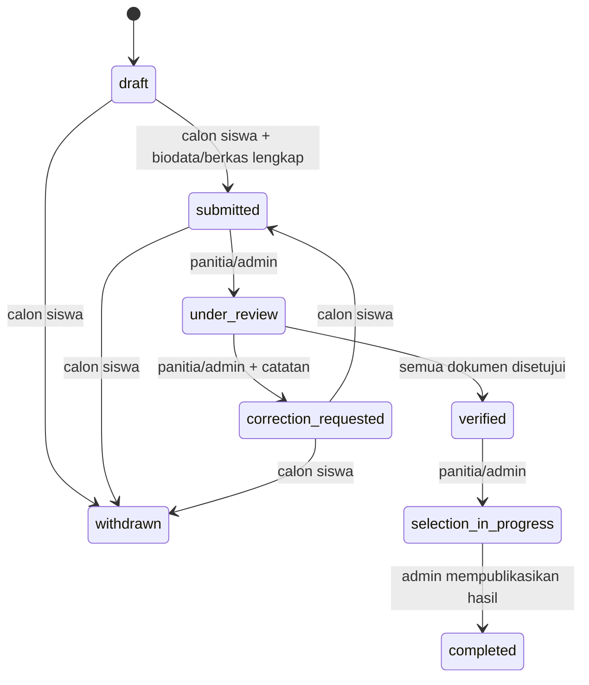

# Analisis repository dan keputusan desain

## Temuan pada 6 November 2026

Remote: `https://github.com/samueltbn27/BSC-ADMISSIONS`. Metadata GitHub menyebut default `main`, tetapi repository kosong (tidak ada refs/commit, file, PR atau perubahan tim). Akses akun kerja: WRITE. Folder awal pengguna adalah repository lain (`REVO-LAB`) yang bersih; pekerjaan dilakukan di checkout terpisah `BSC-ADMISSIONS`. Tidak ada README/AGENTS/dokumentasi atau dependency milik BSC yang dapat dibaca. Instruksi Next.js di workspace awal tidak relevan karena tidak ada kode Next.js yang dibuat/diubah.

Tidak ada database, backend, ORM, konfigurasi environment, maupun konvensi migration existing. PostgreSQL dipilih sesuai fallback pada requirement. Tidak ada database kedua dalam aplikasi atau framework baru. Python hanya runner SQL dan tes, bukan backend. Commit dasar kosong `main` telah diizinkan pengguna khusus untuk dasar PR; seluruh implementasi berada pada `feature/database-husni`.

## Model data dan normalisasi

1. UUID v4 untuk entitas transaksi/identitas; ID tidak mengandung email, NIK, atau urutan pendaftaran. Lookup jurusan/jenis dokumen memakai identity `smallint`, role memakai kode stabil. Nomor pendaftaran deterministik dari UUID penuh dan UNIQUE; nomor ini bukan faktor autentikasi.
2. Akun → profil adalah 1:0..1, profil → pendaftaran adalah 1:N, dengan UNIQUE `(applicant_profile_id, period_id)` untuk satu aplikasi per periode termasuk setelah penarikan. Pendaftaran → hasil adalah 1:0..1. Semua FK menggunakan `ON DELETE RESTRICT ON UPDATE RESTRICT`; penghapusan akun/tabel referensi tidak menghapus jejak proses secara berantai.
3. Lookup role, jurusan, periode, jenis dokumen dipisahkan. Tidak ada daftar jurusan/dokumen berbentuk CSV, nama jurusan pada setiap aplikasi, atau kredensial dalam profil. Satu ijazah **atau** SKL menempati slot `graduation_proof`, bukan dua persyaratan wajib yang terpisah.
4. Model operasional memenuhi 3NF: atribut bergantung pada kunci tabelnya, bukan nama/kode relasi lain. UNIQUE tambahan seperti `(document.id, application_id)` diperlukan untuk FK komposit verifikasi yang memastikan dokumen berasal dari aplikasi yang sama.
5. Dua salinan terkontrol menyimpan fakta historis: `applications.profile_snapshot` adalah biodata pada pengiriman terakhir, dan `verification_records.document_revision` adalah revisi saat pemeriksaan. Keduanya sengaja mempertahankan keadaan waktu kejadian, bukan cache yang harus mengikuti sumber saat ini. Snapshot JSONB hanya berisi tujuh field profil, dibuat dari data bertipe/tervalidasi, tidak menerima JSON dari client. Ini pengecualian denormalisasi historis yang didokumentasikan.
6. `applications.status` dan `application_documents.verification_status` menyimpan keadaan terkini; histori/verifikasi bersifat append-only untuk runtime. Fungsi mengubah keadaan dan menulis histori/audit di transaksi yang sama. Role migrator/DBA tetap dapat mengubah data; kredensial ini tidak digunakan backend.

## Status dan konsistensi

`completed` dan `withdrawn` terminal pada kontrak awal. Perubahan pilihan jurusan/unggah hanya ketika draft atau perbaikan. Profil aktif terkunci ketika ada aplikasi submitted/under_review/verified/selection_in_progress. Setelah selesai, profil dapat diperbarui untuk periode berikutnya; aplikasi lama tetap membaca snapshot pengirimannya. Saat perbaikan, tampilan profil memakai profil hidup dan snapshot diperbarui saat resubmit. `submitted_at` mempertahankan waktu pengiriman pertama; histori memuat seluruh resubmit.

Pembuatan/pengiriman hanya ketika periode aktif dan berada pada interval `[opens_at, closes_at)`, serta jurusan aktif. Penarikan/perbaikan/verifikasi mengikuti state di atas; perbaikan melewati batas tutup belum diizinkan sebagai asumsi konservatif. Dokumen wajib dicek dari konfigurasi yang aktif saat submit/verifikasi; tim perlu membekukan perubahan persyaratan selama satu periode atau menambah persyaratan per periode dalam migration berikutnya.

Pengumuman menggunakan `announcement_at`, lalu admin memanggil publish setelah jadwal itu. Tidak ada publikasi otomatis oleh waktu saja. Keputusan yang belum publish hanya terlihat admin. Publikasi sekaligus mengubah aplikasi menjadi completed; hasil tidak dapat diedit setelah publish. Waitlist terminal pada versi awal; promosi waitlist/ralat hasil memerlukan workflow baru yang ditinjau tim.

## Transaksi, dokumen, indeks

Setiap fungsi merupakan bagian dari transaksi pemanggil. Kunci `FOR UPDATE` pada aplikasi menserialisasi perubahan status, upload, verifikasi dan publikasi; advisory lock per pengguna menserialisasi save profil/pembuatan aplikasi. `_role` mengunci akun `FOR SHARE` untuk mencegah perubahan status/role akun di tengah operasi. Uniqueness tetap ditangani database saat transaksi berlomba. Backend mengulang transaksi secara terbatas untuk SQLSTATE `40001`/`40P01`.

Dokumen tetap berada di object storage privat; database hanya menyimpan key acak `applications/<application_uuid>/<object_uuid>`, MIME, ukuran, revisi dan status. Tidak menyimpan URL publik, nama file asli, atau konten. Penggantian wajib memakai key baru dan mereset pending. Catatan verifikasi menyimpan revisi sebelumnya meski slot dokumen diperbarui; riwayat metadata/file lengkap setiap revisi belum disimpan. Jika diperlukan untuk retensi bukti, tambahkan tabel versi dan kebijakan object storage sebelum produksi.

Indeks UNIQUE otomatis mendukung email, kepemilikan profil, pendaftaran per periode, nomor pendaftaran, slot dokumen dan hasil per aplikasi. Indeks tambahan mendukung antrean `(period_id,status,created_at)`, jurusan, FK aktor, histori/verifikasi per aplikasi dan audit per aktor/entitas. Tidak mengindeks alamat, telepon, snapshot atau catatan bebas yang tidak punya kebutuhan pencarian. Validasi performa harus memakai volume sintetis yang mewakili beban sekolah.

## Asumsi yang perlu disepakati

- TJKT adalah kode kanonis requirement. Tidak ada dokumentasi sekolah dalam repository untuk memverifikasi penamaan resmi; nama lima jurusan mengikuti brief dan perlu pengesahan Samuel. Alias TKJT ditolak.
- Tidak menambah NIK/NISN, pembayaran, Dapodik, akademik atau mobile native.
- Panitia dianggap satu tim untuk seluruh periode; belum ada pembatasan per penugasan/jurusan. Jika dibutuhkan, tambahkan assignment dan pemeriksaan pada fungsi, bukan hanya filter UI.
- Tiga dokumen wajib dan batas 5 MiB/type adalah asumsi awal yang perlu disahkan BA. File pendukung satu slot; kebutuhan beberapa file memerlukan pengembangan model.
- Email lower/trim, panjang 254, dengan validasi pola dasar; dukungan alamat internasional dan kebijakan normalisasi provider belum ditentukan. Telepon memakai E.164. Semua waktu `timestamptz`, simpan instan dan tampilkan zona Asia/Jakarta oleh aplikasi.
- Periode dan referensi dikelola migrator/DBA melalui perubahan yang direview sampai endpoint admin tersedia; runtime tidak boleh mengubah tabel secara langsung.
