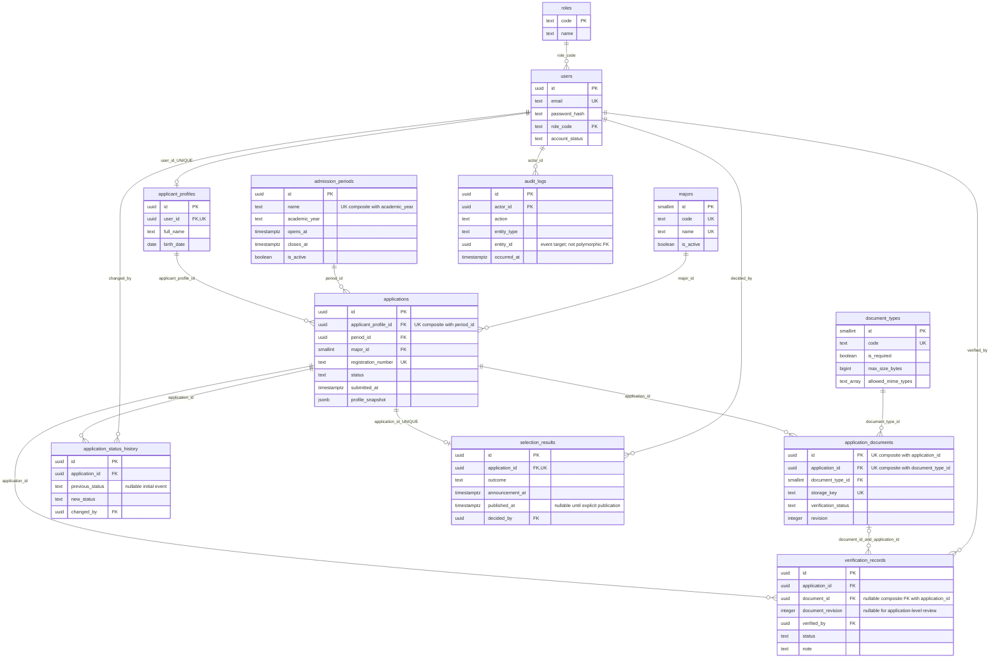

# Entity Relationship Diagram

`||` tepat satu, `o|` nol/satu, `o{` nol/banyak. Semua FK NOT NULL kecuali dokumen pada verifikasi tingkat aplikasi. Lihat [dictionary](DATA_DICTIONARY.md) untuk seluruh kolom dan batas nilai.

`audit_logs.entity_id` adalah target event generik, bukan FK lintas tabel; aktornya memakai FK dan target ditulis oleh fungsi setelah operasi target berhasil. Runtime tidak dapat menulis audit manual. `bsc_meta.migrations` adalah ledger tooling, di luar 12 entitas bisnis.

Constraint penting: satu profil per user; satu aplikasi per profil/periode; satu slot per aplikasi/jenis dokumen; FK komposit verifikasi mencegah dokumen lintas aplikasi; satu hasil per aplikasi; seluruh FK RESTRICT; daftar nilai status dibatasi CHECK. Aturan transisi dan otorisasi dijalankan fungsi SQL yang menjadi satu-satunya akses runtime.
