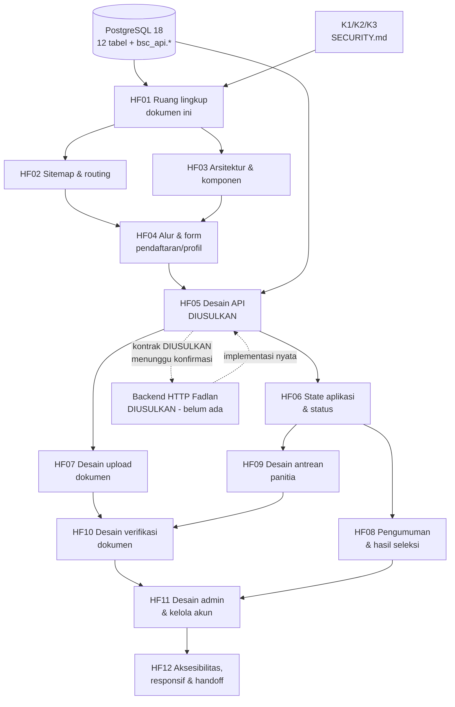

# HF01 — Ruang Lingkup dan Rencana Sprint 1 (Frontend BSC Admissions)

> **Kode tugas:** HF01 · **Sprint:** Sprint 1 (perencanaan/desain saja — bukan implementasi kode)
> **Penulis:** Hafizd Ammar (frontend developer) · **Reviewer:** Fadlan (backend)
> **Status review:** PENDING — lihat [Status review](#status-review) di akhir dokumen.
> **Ground truth:** PostgreSQL 18, 12 tabel, `docs/database/INTEGRATION.md`,
> `DATA_DICTIONARY.md`, `SECURITY.md`, `DESIGN.md`. Semua contoh memakai data
> fiktif/dummy; nama contoh "Calon Siswa Contoh", email `...@example.test`.

## 1. Tujuan

Dokumen ini menetapkan **apa yang masuk dan tidak masuk** ruang lingkup frontend
Sprint 1 untuk sistem PPDB SMK Bina Sarana Cendekia (BSC Admissions), memetakan
dependensi antar pekerjaan, dan menyusun urutan kerja HF02–HF12 beserta kriteria
selesai Sprint 1. Dokumen ini adalah dokumen perencanaan — **bukan** spesifikasi
implementasi dan **bukan** kode.

## 2. Konteks dan ground truth yang mengikat

| Aspek | Fakta (dari kontrak database) |
|---|---|
| Database | PostgreSQL 18; 12 tabel pada skema `bsc` (+ ledger `bsc_meta.migrations`) |
| Peran | `applicant` (calon siswa), `committee` (panitia), `admin` — kode role stabil di tabel `roles` |
| Jurusan | 5 program: TJKT (kanonis — kode TKJT ditolak), PPLG, ANIMASI, MPLB, OTOMOTIF. Nama dan deskripsi jurusan diambil dari katalog (`bsc_api.get_catalog`), **bukan** hardcode di frontend |
| Dokumen wajib | 3 slot: `graduation_proof` (ijazah **ATAU** SKL — satu slot, bukan dua syarat terpisah), `family_card` (kartu keluarga), `photo` (pas foto); plus 1 slot opsional `supporting` |
| Batas upload | Maksimum 5 MiB per jenis dokumen (default `max_size_bytes` 5242880); MIME yang diizinkan hanya PDF/JPEG/PNG; `photo` hanya JPEG/PNG |
| Status aplikasi | 8 nilai: `draft` → `submitted` → `under_review` → `correction_requested` → `verified` → `selection_in_progress` → `completed`, ditambah `withdrawn` (terminal). Lihat state machine di `docs/database/DESIGN.md` |
| Profil | 7 field: `full_name` (1–150 karakter), `birthplace` (1–100), `birth_date` (≥ 1900-01-01), `gender` (L/P), `address` (1–1000), `phone` (E.164, `+` diikuti 8–15 digit, digit awal bukan nol), email maks 254 karakter |
| Nomor pendaftaran | `BSC-<UUID>` (format `BSC-` + UUID tanpa tanda hubung, huruf besar), dihasilkan database, **bukan** faktor autentikasi |
| Fungsi database | `bsc_api.*` di `docs/database/INTEGRATION.md`: `register_account`, `save_profile`, `get_catalog`, `create_application`, `change_major`, `put_document`, `change_application_status`, `verify_document`, `save_selection_result`, `publish_selection_result`, `get_application`, `list_applications`, `manage_account`, `replace_password_hash` |
| Backend HTTP | **TIDAK ADA.** Tidak ada backend HTTP, OpenAPI, endpoint, maupun frontend yang sudah ada. Seluruh kontrak HTTP dalam dokumen Sprint 1 ini berlabel **DIUSULKAN (proposed)** dan menunggu backend Fadlan |
| Keamanan | K1 (autentikasi aman), K2 (RBAC & ownership), K3 (validasi input & pencegahan SQL injection) — lihat `docs/database/SECURITY.md` |

## 3. Verifikasi fitur PPDB (cakupan fungsional Sprint 1)

Sprint 1 merencanakan — dan **hanya** merencanakan — fitur berikut. Setiap fitur
di bawah ini ditelusuri ke fungsi `bsc_api.*` atau tabel yang menjadi sumber
kebenarannya.

### 3.1 Pendaftaran akun dan profil (HF04, HF05)

- **Registrasi akun calon siswa** — email + password → `bsc_api.register_account`.
  Fungsi ini **tidak menerima role**: akun baru selalu `applicant`. Frontend tidak
  boleh menampilkan pilihan role saat registrasi.
- **Login** — autentikasi dilakukan backend melalui `bsc_auth.lookup_account`
  (hanya pool autentikasi). Frontend tidak pernah menerima, menyimpan, atau
  menampilkan `password_hash` (Argon2id PHC). Pesan error login harus generik
  (tidak membedakan akun ada/tidak) — sesuai K1.
- **Profil 7 field** — form profil memetakan 1:1 ke `bsc_api.save_profile` dan
  kolom `applicant_profiles`. Validasi client-side **mencerminkan** batas database
  (panjang, pola E.164, `birth_date` ≥ 1900-01-01), tetapi validasi server/database
  tetap otoritatif (K3). Field nullable di database memungkinkan draft; **submit
  mewajibkan ketujuh field terisi** — frontend harus menegakkan checklist ini
  sebelum tombol kirim aktif.
- **Satu aplikasi per siswa per periode** — constraint `UNIQUE
  (applicant_profile_id, period_id)`. UI "Buat aplikasi" tidak ditampilkan bila
  siswa sudah punya aplikasi pada periode aktif.

### 3.2 Aplikasi dan pemilihan jurusan (HF04, HF06)

- **Buat aplikasi (draft)** — pilih periode aktif + satu jurusan dari katalog →
  `bsc_api.create_application`. Jurusan ditampilkan dari `get_catalog` (kode +
  nama), bukan daftar hardcode; TJKT adalah satu-satunya kode kanonis.
- **Ganti jurusan** — hanya saat `draft` atau `correction_requested` →
  `bsc_api.change_major`.
- **Kirim (submit)** — hanya dari `draft`/`correction_requested` dan hanya bila
  7 field profil lengkap + 3 dokumen wajib terunggah → `change_application_status
  ('submitted')`. Saat submit, database membuat `profile_snapshot` (7 field) —
  frontend tidak mengirim JSON snapshot dari client.
- **Tarik (withdraw)** — dari `draft`, `submitted`, atau `correction_requested` →
  status `withdrawn` (terminal). Penarikan tidak menghapus data (FK RESTRICT;
  akun ditutup lewat status `closed`, bukan dihapus).

### 3.3 Dokumen (HF07)

- **Unggah per slot** — satu slot per jenis dokumen (`UNIQUE (application_id,
  document_type_id)`). Unggah → staging privat di server → `bsc_api.put_document`
  dengan `storage_key` acak. Frontend **tidak pernah** menerima/mengirim
  `storage_key` sebagai URL publik, dan tidak menampilkan nama file asli
  (tidak disimpan di DB).
- **Penggantian dokumen** — wajib memakai key baru; status verifikasi slot
  direset ke `pending` dan `revision` naik. UI harus menunjukkan nomor revisi
  yang sedang diperiksa.
- **Aturan per jenis** — `graduation_proof`: PDF/JPEG/PNG (ijazah **atau** SKL);
  `family_card`: PDF/JPEG/PNG; `photo`: JPEG/PNG saja; `supporting` (opsional):
  PDF/JPEG/PNG. Maksimum 5 MiB per jenis. Validasi ukuran/MIME di client bersifat
  bantuan awal; pemeriksaan isi/MIME/ukuran/malware dilakukan server (K3,
  `SECURITY.md`).
- **Unduh** — hanya lewat otorisasi server (link privat singkat/stream server
  setelah `get_application` memastikan ownership). Tidak ada endpoint publik
  berdasarkan `storage_key`.

### 3.4 Status dan riwayat (HF06, HF08)

- **Status terkini** — 8 nilai dari `applications.status`; label ditampilkan
  ramah-siswa, tetapi nilai literal API tetap dipakai di logika (jangan
  menerjemahkan literal menjadi kunci lain).
- **Riwayat status** — `application_status_history` (append-only): siswa melihat
  urutan perubahan status + catatan (maks 1000 karakter, tanpa PII berlebih).
- **Hasil seleksi `null` ≠ gagal** — `get_application` mengembalikan
  `selection_result` berupa JSON `null` bila hasil belum tersedia bagi aktor
  tersebut. UI **dilarang** menyimpulkan "tidak lulus" dari nilai `null`.

### 3.5 Pengumuman dan hasil seleksi (HF08, HF12)

- **Alur publikasi** — admin menyimpan hasil (`save_selection_result`, outcome
  `accepted`/`waitlisted`/`rejected`, `announcement_at`) lalu mem-publish secara
  eksplisit (`publish_selection_result`) setelah jadwal terpenuhi; publikasi
  mengubah aplikasi menjadi `completed`. **Tidak ada publikasi otomatis** oleh
  waktu saja.
- **Visibilitas** — hasil sebelum publish hanya terlihat admin; sesudah publish,
  siswa melihat hasilnya sendiri, panitia melihat hasil aplikasi yang dapat
  mereka lihat. Frontend tidak boleh menampilkan hasil sebelum `published_at`
  terisi.
- **Waitlist** — pada kontrak awal, `waitlisted` bersifat terminal; promosi
  waitlist/ralat hasil memerlukan workflow baru dan **di luar** Sprint 1.

### 3.6 Peran panitia dan admin (HF09, HF10, HF11)

- **Panitia** — membaca antrean seluruh periode (`list_applications`), membuka
  detail aplikasi, memindahkan `submitted` → `under_review`, memverifikasi
  dokumen (`verify_document`: `approved`/`correction_requested`, catatan wajib
  saat perbaikan), dan memindahkan `under_review` → `verified` bila semua
  dokumen disetujui. Panitia **tidak** dapat menyimpan/mempublish hasil seleksi
  dan **tidak** dapat mengelola akun.
- **Admin** — seluruh kemampuan panitia + menyimpan/mempublish hasil seleksi +
  mengelola role/status akun lain (`manage_account`). Batas: siswa yang sudah
  berprofil tetap `applicant` (tidak dapat diubah role-nya lewat fungsi ini).
- **Batas K2 yang harus dihormati UI** — kontrol UI berdasarkan role **bukan**
  pengaman utama; otorisasi ditegakkan server. Frontend menyembunyikan aksi yang
  tidak diizinkan untuk mengurangi kebingungan, tetapi tidak pernah mengklaim
  bahwa penyembunyian itu adalah keamanan.

## 4. Di luar ruang lingkup Sprint 1

| Item | Alasan |
|---|---|
| Implementasi kode apa pun (komponen, halaman, API client) | Sprint 1 = perencanaan/desain saja |
| HB01–HB05 (implementasi Sprint 2+: setup proyek, auth UI, form pendaftaran, upload, dashboard panitia) | Dijadwalkan Sprint 2+, bukan Sprint 1 |
| Backend HTTP / OpenAPI | Milik Fadlan; frontend hanya mengusulkan kontrak (DIUSULKAN) |
| Pembayaran, Dapodik, akademik, mobile native | Bukan bagian kontrak awal (`DESIGN.md`) |
| NIK/NISN | Sengaja tidak dikumpulkan (`DATA_DICTIONARY.md`) |
| Promosi waitlist / ralat hasil setelah publish | Memerlukan workflow baru yang ditinjau tim |
| Perubahan state machine / constraint | Harus melalui migration berikutnya, disahkan Samuel |
| Publikasi otomatis hasil seleksi | Tidak ada dalam kontrak; publish selalu eksplisit oleh admin |

## 5. Peta dependensi

Penjelasan dependensi utama:

- **Desain ↔ DB:** semua dokumen HF02–HF12 mengacu ke `DATA_DICTIONARY.md`
  (nama field, batas panjang, enum) dan `DESIGN.md` (state machine). Bila ada
  konflik, kontrak database menang; perubahan butuh migration baru.
- **Desain ↔ API:** HF05 (kontrak HTTP DIUSULKAN) bergantung pada HF04
  (alur/formulir) dan menjadi masukan bagi HF06–HF11. Kontrak HTTP tidak dapat
  difinalisasi sebelum backend Fadlan mengonfirmasi bentuk endpoint, sesi, dan
  error mapping.
- **Desain ↔ keamanan:** K1/K2/K3 membatasi setiap halaman: tidak ada hash/secret
  ke frontend, tidak ada otorisasi berbasis input client, tidak ada URL publik
  dari `storage_key`, pesan error generik tanpa detail SQL.
- **Frontend ↔ backend:** frontend tidak memanggil PostgreSQL langsung dan tidak
  menerima `actor`/`role` dari body/query request — aktor selalu berasal dari
  sesi server yang terverifikasi (K2).

## 6. Urutan kerja HF02–HF12

| Urutan | Tugas | Masukan | Keluaran |
|---|---|---|---|
| 1 | HF02 — Daftar halaman, sitemap & routing | HF01, katalog jurusan | Daftar halaman per peran + route map |
| 2 | HF03 — Arsitektur frontend & komponen | HF01, HF02 | Rekomendasi framework + component tree + data flow |
| 3 | HF04 — Alur & form pendaftaran/profil | HF02, HF03, `save_profile`/`create_application` | Wireframe deskriptif alur daftar → profil → pilih jurusan → submit |
| 4 | HF05 — Desain kontrak API (DIUSULKAN) | HF04, `INTEGRATION.md` | Tabel endpoint DIUSULKAN + pemetaan ke `bsc_api.*` + error mapping |
| 5 | HF06 — State aplikasi & status | HF05, state machine `DESIGN.md` | Diagram state + tampilan status per peran |
| 6 | HF07 — Desain upload dokumen | HF05, `application_documents` | Aturan per slot, revisi, pesan error |
| 7 | HF08 — Pengumuman & hasil seleksi | HF06, `selection_results` | Aturan visibilitas + tampilan hasil |
| 8 | HF09 — Desain antrean panitia | HF06, `list_applications` | Tabel antrean, filter, paginasi |
| 9 | HF10 — Desain verifikasi dokumen | HF07, HF09, `verify_document` | Alur review + catatan perbaikan |
| 10 | HF11 — Desain admin & kelola akun | HF08, HF10, `manage_account` | Halaman kelola akun + simpan/publish hasil |
| 11 | HF12 — Aksesibilitas, responsif & handoff | HF02–HF11 | Checklist a11y/responsif + paket handoff ke Sprint 2 |

Urutan ini sekuensial secara logis (halaman → arsitektur → alur → API → fitur
per peran → handoff), tetapi HF02 dan HF03 dapat dikerjakan paralel setelah
HF01 disahkan, dan HF07–HF10 dapat dikerjakan paralel setelah HF05 selesai.

## 7. Timing kontrak API (DIUSULKAN — menunggu backend Fadlan)

- **Status saat ini:** belum ada backend HTTP, OpenAPI, atau endpoint apa pun.
  Seluruh kontrak HTTP yang ditulis pada Sprint 1 berlabel **DIUSULKAN**.
- **Yang dibutuhkan dari Fadlan (backend):**
  1. Konfirmasi bentuk endpoint HTTP untuk setiap fungsi `bsc_api.*`
     (path, method, request/response JSON).
  2. Konfirmasi mekanisme sesi (cookie aman, CSRF, expiry/revokasi, invalidasi
     saat `password_changed_at` berubah) dan rate limit.
  3. Konfirmasi error mapping: `42501` → 403/404 generik, `23505` → 409 generik,
     `23514`/`23502`/`23503`/`23001`/`22P02` → 400/422 generik, lainnya → 500
     dengan request ID — tanpa detail SQLSTATE/constraint ke client.
  4. Konfirmasi alur upload (staging privat → validasi isi/MIME/ukuran/malware →
     `put_document`) dan alur unduh (link privat singkat/stream server).
  5. Konfirmasi kebijakan verifikasi email, pemulihan akun, dan pencegahan
     enumerasi email saat login (K1).
- **Dampak ke Sprint 1:** dokumen HF05 ditulis berdasarkan fungsi `bsc_api.*`
  sebagai sumber kebenaran dan diberi label DIUSULKAN; finalisasi kontrak
  menunggu jawaban Fadlan. Keterlambatan jawaban ini **tidak memblokir**
  HF02–HF04 dan HF06–HF12, tetapi memblokir dimulainya implementasi (HB01+)
  pada Sprint 2.
- **Dampak ke Sprint 2:** HB01 (setup proyek) dapat dimulai tanpa kontrak final,
  tetapi HB02+ (auth UI, form, upload) membutuhkan kontrak HTTP yang sudah
  dikonfirmasi.

## 8. Risiko dan asumsi

| # | Risiko / Asumsi | Dampak | Mitigasi |
|---|---|---|---|
| R1 | Kontrak HTTP belum ada; backend Fadlan belum mengonfirmasi bentuk endpoint/sesi | Desain API (HF05) bisa berubah saat implementasi | Beri label DIUSULKAN pada semua endpoint; jadikan fungsi `bsc_api.*` sebagai sumber kebenaran yang stabil |
| R2 | Nama resmi 5 jurusan belum disahkan Samuel (asumsi dari brief; TJKT kanonis, TKJT ditolak) | Label jurusan di UI bisa salah | Tampilkan nama dari `get_catalog`; pengesahan Samuel dicatat sebagai item pending di HF02 |
| R3 | Tiga dokumen wajib + batas 5 MiB adalah asumsi awal yang perlu disahkan BA | Persyaratan upload bisa berubah | Catat sebagai asumsi; perubahan persyaratan harus lewat migration, bukan edit UI semata |
| R4 | Perbaikan melewati batas tutup periode belum diizinkan (asumsi konservatif) | Siswa yang terlambat memperbaiki bisa terkunci | UI harus menampilkan tenggat dengan jelas; keputusan akhir menunggu Samuel |
| R5 | Panitia dianggap satu tim lintas periode (tanpa assignment per jurusan) | Filter antrean per jurusan belum tentu cukup | Jangan bangun pembatasan assignment di UI; bila dibutuhkan, tambahkan pemeriksaan di fungsi, bukan hanya filter UI |
| R6 | Retensi PII, akses orang tua, dan persetujuan belum ditetapkan sekolah | Kebijakan privasi halaman belum final | Jangan janjikan penghapusan data di UI; penutupan akun ≠ penghapusan data |
| R7 | Profil terkunci saat aplikasi berstatus `submitted`/`under_review`/`verified`/`selection_in_progress` | Siswa bisa bingung mengapa profil tidak bisa diubah | UI menjelaskan status kunci dan kapan profil dapat diubah lagi (setelah selesai, untuk periode berikutnya) |
| R8 | Dokumen pengganti mereset verifikasi ke `pending` dan menaikkan revisi | Siswa/panitia bisa salah membaca status revisi lama | UI selalu menampilkan nomor revisi yang sedang berlaku |
| A1 | Periode dan referensi dikelola migrator/DBA sampai endpoint admin tersedia | Frontend tidak menyediakan CRUD periode/jurusan pada Sprint 1 | Halaman admin Sprint 1 hanya merencanakan kelola akun + hasil seleksi |
| A2 | Semua waktu disimpan `timestamptz`; tampilan memakai zona Asia/Jakarta | Jadwal `opens_at`/`closes_at`/`announcement_at` harus tampil konsisten | Tetapkan Asia/Jakarta sebagai zona tampil di HF12 |

## 9. Kriteria selesai Sprint 1

Sprint 1 dinyatakan selesai bila **semua** kondisi berikut terpenuhi:

1. Dokumen HF01–HF12 lengkap, ditulis dalam Bahasa Indonesia, dan tersimpan di
   `docs/frontend/sprint-1/` pada branch `frontend-dev-hafizd`.
2. Setiap dokumen mengacu ke ground truth database (tabel, fungsi, status, batas)
   dan tidak menginventarisasi endpoint, log, atau bukti yang tidak ada.
3. Seluruh kontrak HTTP diberi label **DIUSULKAN**; tidak ada klaim bahwa backend
   HTTP sudah ada.
4. Semua contoh memakai data fiktif/dummy (`example.test`, "Calon Siswa Contoh");
   tidak ada data siswa nyata.
5. Setiap dokumen ditutup bagian "Status review" yang menyatakan review PENDING
   dan persetujuan belum diperoleh, dengan nama reviewer yang benar.
6. HF01 direview Fadlan; HF02 direview Samuel (navigasi/role); HF03 direview
   Fadlan (arsitektur). Review HF04–HF12 mengikuti penugasan masing-masing.
7. Daftar pertanyaan pending (nama jurusan, tenggat perbaikan, kebijakan
   penarikan/waitlist/retensi PII, jalur ralat hasil) tercatat dan diteruskan ke
   Samuel/Fadlan — bukan diputuskan sepihak oleh frontend.
8. Tidak ada kode aplikasi yang ditulis pada Sprint 1; tidak ada HB01–HB05 yang
   dibangun.

## 10. Contoh fiktif yang dipakai di seluruh dokumen Sprint 1

Agar konsisten, semua dokumen Sprint 1 memakai contoh yang sama (data dummy):

- Calon siswa: "Calon Siswa Contoh", email `calon.contoh@example.test`
- Nomor pendaftaran contoh: `BSC-` + UUID contoh (mis. `BSC-123E4567E89B12D3A456426614174000`)
- Jurusan contoh: TJKT; periode contoh: "Gelombang 1 2026/2027"
- Dokumen contoh: ijazah (sebagai `graduation_proof`), kartu keluarga,
  pas foto — semuanya file dummy tanpa isi dokumen nyata

## Status review

- **Status: PENDING.** Dokumen ini belum direview.
- **Reviewer:** Fadlan (backend).
- **Persetujuan:** BELUM diperoleh. Tidak ada persetujuan dari Fadlan — atau dari
  Samuel, Rizki, maupun pihak lain — atas isi dokumen ini.
- **Tindak lanjut:** menunggu review Fadlan atas ruang lingkup, peta dependensi,
  urutan kerja, dan timing kontrak API di atas.
