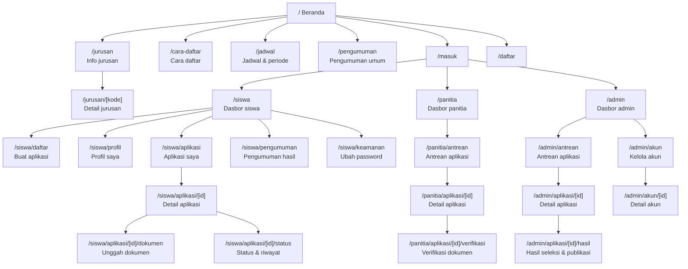
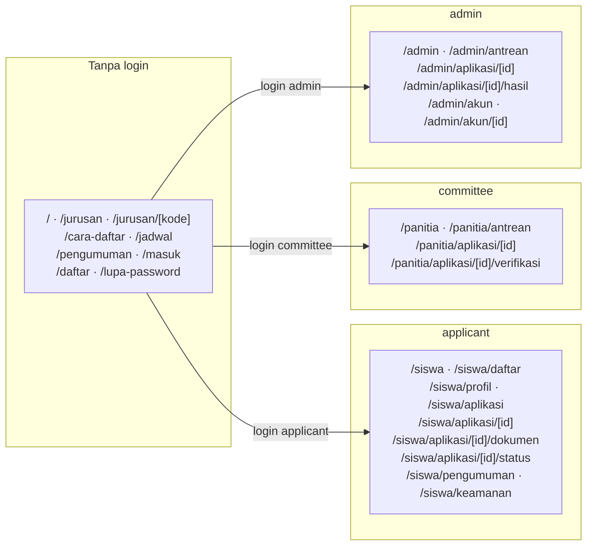

# HF02 — Daftar Halaman, Sitemap, dan Routing (Frontend BSC Admissions)

> **Kode tugas:** HF02 · **Sprint:** Sprint 1 (perencanaan/desain saja — bukan implementasi kode)
> **Penulis:** Hafizd Ammar (frontend developer) · **Reviewer:** Samuel (BA/UI/UX)
> **Status review:** PENDING — lihat [Status review](#status-review) di akhir dokumen.
> **Ground truth:** PostgreSQL 18, 12 tabel, `docs/database/INTEGRATION.md`,
> `DATA_DICTIONARY.md`, `SECURITY.md`, `DESIGN.md`. Semua contoh memakai data
> fiktif/dummy; nama contoh "Calon Siswa Contoh", email `...@example.test`.
> **Catatan:** tidak ada backend HTTP, OpenAPI, atau frontend yang sudah ada.
> Route dan kontrak HTTP dalam dokumen ini berlabel **DIUSULKAN (proposed)**.

## 1. Tujuan

Dokumen ini menetapkan daftar lengkap halaman frontend BSC Admissions per peran
(publik, calon siswa, panitia, admin), sitemap dan route map sebagai diagram
Mermaid, serta aturan navigasi per peran. Dokumen ini adalah dokumen perencanaan
— **bukan** spesifikasi implementasi dan **bukan** kode.

## 2. Prinsip routing

1. **Satu halaman = satu tanggung jawab.** Setiap halaman memetakan ke satu
   fungsi `bsc_api.*` atau satu tampilan baca yang jelas (lihat kolom "Sumber
   data" pada tiap tabel).
2. **Route mengikuti peran, bukan sebaliknya.** Navigasi yang ditampilkan
   bergantung pada `role_code` dari sesi server (`applicant`/`committee`/
   `admin`). Role tidak pernah diambil dari body/query request (K2).
3. **Kontrol UI bukan pengaman.** Menyembunyikan menu dari peran yang tidak
   berhak hanya mengurangi kebingungan; otorisasi sesungguhnya ditegakkan
   server/backend (K2).
4. **Tidak ada data hardcode.** Daftar jurusan, jenis dokumen, dan periode
   selalu diambil dari `bsc_api.get_catalog` — kode jurusan TJKT adalah
   satu-satunya kode kanonis (TKJT ditolak).
5. **Nomor pendaftaran bukan kunci akses.** `registration_number` (`BSC-<UUID>`)
   ditampilkan sebagai identitas aplikasi, bukan sebagai faktor autentikasi
   atau token akses.
6. **Route DIUSULKAN.** Path URL di bawah ini adalah usulan; path final
   mengikuti keputusan arsitektur (HF03) dan konfirmasi backend (HF05).

## 3. Daftar halaman

### 3.1 Halaman publik (tanpa login)

| # | Halaman | Route (DIUSULKAN) | Tujuan | Sumber data |
|---|---|---|---|---|
| P1 | Beranda | `/` | Pengantar PPDB SMK Bina Sarana Cendekia; tautan ke info jurusan, cara daftar, dan login/daftar | Konten statis + ringkasan katalog (jurusan aktif) |
| P2 | Info jurusan | `/jurusan` | Daftar 5 jurusan (TJKT, PPLG, ANIMASI, MPLB, OTOMOTIF) dengan nama + deskripsi | `get_catalog` (majors aktif) |
| P3 | Detail jurusan | `/jurusan/[kode]` | Deskripsi satu jurusan; `[kode]` memakai kode katalog (mis. `tjkt` huruf kecil di URL, kode kanonis TJKT di data) | `get_catalog` |
| P4 | Cara daftar | `/cara-daftar` | Langkah-langkah: buat akun → lengkapi profil 7 field → pilih jurusan → unggah 3 dokumen wajib → kirim → pantau status | Aturan dari HF01 §3; bukan data dinamis |
| P5 | Jadwal & periode | `/jadwal` | Periode aktif: nama, tahun ajaran, `opens_at`–`closes_at` (tampil zona Asia/Jakarta) | `get_catalog` (periods aktif) |
| P6 | Pengumuman (publik) | `/pengumuman` | Pengumuman umum PPDB (bukan hasil seleksi per siswa) | Konten statis / data dari backend bila tersedia (DIUSULKAN) |
| P7 | Masuk (login) | `/masuk` | Form email + password | Backend auth (`bsc_auth.lookup_account` via sesi server) — DIUSULKAN |
| P8 | Daftar akun | `/daftar` | Form registrasi akun calon siswa (email + password); tanpa pilihan role | `register_account` — DIUSULKAN |
| P9 | Lupa password | `/lupa-password` | Alur pemulihan akun | Backend (K1) — DIUSULKAN, menunggu konfirmasi Fadlan |

Catatan P2/P3: nama dan deskripsi jurusan diambil dari katalog. Bila katalog
belum tersedia (backend belum ada), halaman menampilkan placeholder yang
menyatakan data belum tersedia — **bukan** daftar hardcode yang diklaim resmi.

### 3.2 Halaman calon siswa (role `applicant`, sesudah login)

| # | Halaman | Route (DIUSULKAN) | Tujuan | Sumber data |
|---|---|---|---|---|
| S1 | Dasbor siswa | `/siswa` | Ringkasan: status aplikasi aktif, checklist kelengkapan, tenggat periode | `get_application` / `list_applications` |
| S2 | Pendaftaran (buat aplikasi) | `/siswa/daftar` | Pilih periode aktif + satu jurusan → buat draft | `get_catalog`, `create_application` |
| S3 | Profil saya | `/siswa/profil` | Form 7 field profil (nama, tempat lahir, tanggal lahir, gender, alamat, telepon) + email akun (baca saja) | `save_profile`, `get_application` (profile) |
| S4 | Aplikasi saya | `/siswa/aplikasi` | Daftar aplikasi milik sendiri (satu per periode) + nomor `BSC-<UUID>` | `list_applications` (milik sendiri) |
| S5 | Detail aplikasi | `/siswa/aplikasi/[id]` | Status terkini, snapshot profil saat pengiriman terakhir, riwayat status, hasil seleksi (bila sudah publish) | `get_application` |
| S6 | Unggah dokumen | `/siswa/aplikasi/[id]/dokumen` | Unggah/ganti 3 dokumen wajib + 1 opsional; tampilkan status verifikasi + revisi tiap slot | `put_document`, `get_application` (documents) |
| S7 | Status & riwayat | `/siswa/aplikasi/[id]/status` | Linimasa 8 status + riwayat perubahan + catatan perbaikan panitia | `get_application` (history, verifications) |
| S8 | Pengumuman hasil | `/siswa/pengumuman` | Hasil seleksi milik sendiri sesudah publish (`accepted`/`waitlisted`/`rejected`); sebelum publish tampilkan "belum tersedia" — `null` **bukan** berarti gagal | `get_application` (selection_result) |
| S9 | Ubah password | `/siswa/keamanan` | Ganti password sendiri setelah reautentikasi | `replace_password_hash` — DIUSULKAN |

Aturan halaman siswa:

- **S2** tidak menampilkan tombol "Buat aplikasi" bila siswa sudah memiliki
  aplikasi pada periode aktif (constraint satu aplikasi per periode).
- **S3** terkunci (read-only dengan penjelasan) saat ada aplikasi berstatus
  `submitted`/`under_review`/`verified`/`selection_in_progress`; profil dapat
  diubah lagi setelah aplikasi selesai, untuk periode berikutnya.
- **S5/S6** hanya dapat dibuka oleh pemilik aplikasi; percobaan membuka aplikasi
  milik siswa lain harus ditolak server dengan respons generik (403/404 — K2).
  Frontend tidak mengandalkan "UUID sulit ditebak" sebagai pengaman.
- **S6** menonaktifkan unggah saat status aplikasi tidak mengizinkan
  (`draft`/`correction_requested` saja yang boleh ganti jurusan/unggah).
- **S8**: hasil `null` ditampilkan sebagai "Hasil belum diumumkan", bukan
  "Tidak lulus".

### 3.3 Halaman panitia (role `committee`, sesudah login)

| # | Halaman | Route (DIUSULKAN) | Tujuan | Sumber data |
|---|---|---|---|---|
| K1 | Dasbor panitia | `/panitia` | Ringkasan antrean: jumlah per status, per periode | `list_applications` |
| K2 | Antrean aplikasi | `/panitia/antrean` | Tabel aplikasi seluruh periode: nomor pendaftaran, periode, jurusan, status, tanggal dibuat; filter + paginasi (limit 1–100, default 50) | `list_applications` |
| K3 | Detail aplikasi (panitia) | `/panitia/aplikasi/[id]` | Profil snapshot, dokumen, riwayat status, catatan verifikasi | `get_application` |
| K4 | Verifikasi dokumen | `/panitia/aplikasi/[id]/verifikasi` | Setujui/minta perbaikan per dokumen (catatan wajib bila perbaikan) | `verify_document` |
| K5 | Ubah status aplikasi | Aksi di K3/K4 | `submitted` → `under_review`; `under_review` → `verified` (bila semua dokumen disetujui) atau → `correction_requested` | `change_application_status` |

Aturan halaman panitia:

- Panitia melihat antrean **seluruh periode** (satu tim lintas periode, tanpa
  assignment per jurusan pada kontrak awal). Filter per jurusan/periode adalah
  filter tampilan, bukan pembatasan hak akses.
- Panitia **tidak** dapat menyimpan/mempublish hasil seleksi dan **tidak** dapat
  mengelola akun — menu tersebut tidak ditampilkan untuk role ini.
- Verifikasi hanya dapat dilakukan saat status `under_review`
  (`verify_document`); UI menonaktifkan tombol verifikasi di luar state tersebut.
- Catatan perbaikan (maks 1000 karakter) wajib diisi saat status
  `correction_requested`; catatan tidak boleh berisi PII berlebih.

### 3.4 Halaman admin (role `admin`, sesudah login)

| # | Halaman | Route (DIUSULKAN) | Tujuan | Sumber data |
|---|---|---|---|---|
| A1 | Dasbor admin | `/admin` | Ringkasan seluruh periode + antrean + status publikasi | `list_applications` |
| A2 | Antrean aplikasi (admin) | `/admin/antrean` | Sama seperti K2, seluruh periode | `list_applications` |
| A3 | Detail aplikasi (admin) | `/admin/aplikasi/[id]` | Sama seperti K3 + hasil seleksi (termasuk yang belum publish) | `get_application` |
| A4 | Hasil seleksi | `/admin/aplikasi/[id]/hasil` | Simpan hasil (`accepted`/`waitlisted`/`rejected`, `announcement_at`, catatan) | `save_selection_result` |
| A5 | Publikasi hasil | Aksi di A4 | Publish eksplisit sesudah `announcement_at` terpenuhi; publikasi mengubah aplikasi menjadi `completed` | `publish_selection_result` |
| A6 | Kelola akun | `/admin/akun` | Daftar akun; ubah role/status akun lain | `manage_account` |
| A7 | Detail akun | `/admin/akun/[id]` | Lihat akun + ubah role/status; batas: siswa berprofil tetap `applicant` | `manage_account` |

Aturan halaman admin:

- Hasil seleksi sebelum publish **hanya** terlihat admin (A3/A4). Frontend
  tidak menampilkan hasil yang belum publish ke peran lain dalam kondisi apa pun.
- `waitlisted` pada kontrak awal bersifat terminal; tidak ada aksi "promosikan
  waitlist" di Sprint 1.
- Pengelolaan periode/jurusan **tidak** masuk halaman admin Sprint 1: periode
  dan referensi dikelola migrator/DBA sampai endpoint admin tersedia (HF01 §8,
  asumsi A1).
- Admin tidak dapat mengubah tabel/audit secara langsung melalui UI; audit log
  bersifat append-only.

## 4. Sitemap

## 5. Route map (peran → route yang diizinkan)

**Matriks akses route (ringkasan):**

| Kelompok route | Publik | applicant | committee | admin |
|---|---|---|---|---|
| `/`, `/jurusan*`, `/cara-daftar`, `/jadwal`, `/pengumuman` | Ya | Ya | Ya | Ya |
| `/masuk`, `/daftar`, `/lupa-password` | Ya | dialihkan ke dasbor | dialihkan ke dasbor | dialihkan ke dasbor |
| `/siswa*` | Tidak | Milik sendiri | Tidak | Tidak* |
| `/panitia*` | Tidak | Tidak | Ya | Ya (via `/admin/antrean` setara) |
| `/admin*` | Tidak | Tidak | Tidak | Ya |

\* Admin membaca aplikasi lewat route `/admin*`, bukan `/siswa*` — pemisahan ini
menjaga kejelasan peran di navigasi. Detail perilaku pengalihan (redirect) saat
peran salah mengakses route adalah keputusan implementasi (Sprint 2) dan harus
mengikuti otorisasi server, bukan sekadar guard di client.

## 6. Navigasi per peran

### 6.1 Navigasi publik (belum login)

- Logo/beranda · Jurusan · Cara Daftar · Jadwal · Pengumuman · [Masuk] [Daftar]
- Menu "Daftar" hanya untuk calon siswa baru; tidak ada pilihan role di halaman
  pendaftaran (akun baru selalu `applicant`).

### 6.2 Navigasi calon siswa

- Dasbor · Pendaftaran · Profil Saya · Aplikasi Saya · Pengumuman Hasil ·
  Keamanan · [Keluar]
- Indikator kelengkapan di dasbor: 7 field profil + 3 dokumen wajib; tombol
  "Kirim aplikasi" hanya aktif bila checklist lengkap dan status
  `draft`/`correction_requested`.
- Menu menampilkan nomor pendaftaran (`BSC-<UUID>`) sebagai pengenal aplikasi,
  bukan sebagai kredensial.

### 6.3 Navigasi panitia

- Dasbor · Antrean · [Keluar]
- Antrean menampilkan lencana jumlah per status (`submitted` menunggu review,
  `under_review`, `correction_requested`).

### 6.4 Navigasi admin

- Dasbor · Antrean · Kelola Akun · [Keluar]
- Aksi "Simpan hasil" dan "Publish hasil" hanya ada di detail aplikasi admin
  (A4/A5), bukan di navigasi utama.

### 6.5 Aturan navigasi umum

- Pengguna yang sudah login dan membuka `/masuk` atau `/daftar` diarahkan ke
  dasbor perannya.
- Pengguna tanpa sesi yang membuka route berperang diarahkan ke `/masuk`.
- Peran yang salah mengakses route peran lain diarahkan ke dasbor perannya
  sendiri (perilaku final mengikuti otorisasi server).
- Semua label status memakai nilai literal API (`draft`, `submitted`, dst.)
  sebagai kunci, dengan label Bahasa Indonesia sebagai tampilan.

## 7. Halaman yang sengaja TIDAK ada pada Sprint 1

| Halaman | Alasan |
|---|---|
| CRUD periode/jurusan | Dikelola migrator/DBA sampai endpoint admin tersedia |
| Pembayaran | Bukan bagian kontrak awal |
| Promosi waitlist / ralat hasil | Memerlukan workflow baru yang ditinjau tim |
| Penghapusan akun/data | Penutupan akun memakai status `closed`; penghapusan bukan fitur UI |
| Dashboard analitik lanjutan | Di luar kebutuhan antrean panitia/admin Sprint 1 |
| Profil orang tua/wali | Tidak ada dalam model data (tidak ada NIK/NISN) |

## 8. Catatan review navigasi/role dengan Samuel — PENDING

Catatan berikut **menunggu review dan keputusan Samuel (BA/UI/UX)** dan belum
disahkan:

1. **Nama resmi 5 jurusan** — label jurusan di halaman `/jurusan` mengikuti
   katalog, tetapi nama resmi (termasuk penulisan TJKT vs alias TKJT yang
   ditolak) perlu pengesahan Samuel sebelum dipakai sebagai tampilan final.
2. **Struktur navigasi per peran** — pengelompokan menu di §6 (mis. apakah
   "Pengumuman Hasil" terpisah dari "Aplikasi Saya" untuk siswa, dan apakah
   admin memakai route `/admin/antrean` terpisah dari `/panitia/antrean`)
   menunggu masukan Samuel.
3. **Tenggat perbaikan** — tampilan tenggat dan perilaku perbaikan melewati
   batas tutup periode belum diputuskan (asumsi konservatif: tidak diizinkan).
4. **Kebijakan penarikan dan waitlist** — pesan konfirmasi penarikan aplikasi
   dan tampilan status `waitlisted` menunggu keputusan Samuel.
5. **Retensi PII dan jalur ralat hasil** — belum ditetapkan sekolah; memengaruhi
   teks bantuan/privasi di halaman profil dan hasil seleksi.
6. **Pengesahan kebutuhan** — sesuai `INTEGRATION.md`, Samuel mengesahkan nama
   jurusan/TJKT, tiga dokumen wajib, batas upload, role panitia lintas periode,
   gender/telepon, tenggat perbaikan, kebijakan penarikan dan waitlist, retensi
   PII, serta jalur ralat hasil. Sampai pengesahan itu ada, dokumen ini memakai
   asumsi dari kontrak database dan menandainya sebagai pending.

Tidak ada satu pun poin di atas yang diklaim sudah disetujui Samuel.

## 9. Contoh fiktif

- Calon siswa contoh: "Calon Siswa Contoh" — `calon.contoh@example.test`
- Aplikasi contoh: nomor `BSC-123E4567E89B12D3A456426614174000`, jurusan TJKT,
  periode "Gelombang 1 2026/2027", status contoh `submitted`
- Dokumen contoh: ijazah (slot `graduation_proof`), kartu keluarga, pas foto —
  file dummy tanpa isi dokumen nyata

## Status review

- **Status: PENDING.** Dokumen ini belum direview.
- **Reviewer:** Samuel (BA/UI/UX).
- **Persetujuan:** BELUM diperoleh. Samuel belum menyetujui daftar halaman,
  sitemap, route map, maupun navigasi per peran dalam dokumen ini — termasuk
  enam poin pending pada §8. Tidak ada persetujuan dari Samuel, Fadlan, Rizki,
  maupun pihak lain atas isi dokumen ini.
- **Tindak lanjut:** menunggu review Samuel atas struktur navigasi/role dan
  keputusan atas poin-poin pending di §8.
