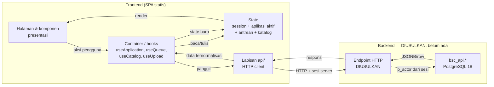

# HF03 — Arsitektur Frontend dan Komponen (Frontend BSC Admissions)

> **Kode tugas:** HF03 · **Sprint:** Sprint 1 (perencanaan/desain saja — bukan implementasi kode)
> **Penulis:** Hafizd Ammar (frontend developer) · **Reviewer:** Fadlan (arsitektur)
> **Status review:** PENDING — lihat [Status review](#status-review) di akhir dokumen.
> **Ground truth:** PostgreSQL 18, 12 tabel, `docs/database/INTEGRATION.md`,
> `DATA_DICTIONARY.md`, `SECURITY.md`, `DESIGN.md`. Semua contoh memakai data
> fiktif/dummy; nama contoh "Calon Siswa Contoh", email `...@example.test`.
> **Catatan:** tidak ada backend HTTP, OpenAPI, atau frontend yang sudah ada.
> Kontrak HTTP dalam dokumen ini berlabel **DIUSULKAN (proposed)**.

## 1. Tujuan

Dokumen ini menetapkan arsitektur frontend BSC Admissions: rekomendasi framework
utama beserta alternatifnya, struktur folder dan komponen, component tree,
aliran state dan data, serta pemisahan komponen presentasi vs container.
Dokumen ini adalah dokumen perencanaan — **bukan** spesifikasi implementasi
dan **bukan** kode. Pemilihan framework di sini adalah **rekomendasi** yang
menunggu review Fadlan (arsitektur) — lihat §8.

## 2. Kebutuhan arsitektur (diturunkan dari ground truth)

| # | Kebutuhan | Sumber |
|---|---|---|
| A1 | Aplikasi web multi-peran (publik, `applicant`, `committee`, `admin`) dengan navigasi berbeda per peran | HF02 |
| A2 | Formulir kompleks: profil 7 field dengan batas panjang/pola ketat, pilih jurusan dari katalog, unggah 3+1 dokumen (maks 5 MiB, MIME terbatas) | `DATA_DICTIONARY.md`, HF01 §3 |
| A3 | State aplikasi berstatus: 8 status dengan transisi state machine yang ketat; tampilan berbeda per status dan per peran | `DESIGN.md` |
| A4 | Tidak ada backend HTTP saat ini — frontend harus dirancang agar kontrak HTTP DIUSULKAN dapat diganti implementasi nyata tanpa merombak UI | `INTEGRATION.md` |
| A5 | Keamanan K1/K2/K3: tidak ada secret/hash ke client, tidak ada otorisasi berbasis input client, tidak ada URL publik dari `storage_key`, pesan error generik | `SECURITY.md` |
| A6 | Deploy sederhana dan murah: situs sekolah tanpa infrastruktur server aplikasi yang kompleks; idealnya dapat disajikan sebagai situs statis di depan backend API | Konteks proyek (tanpa backend HTTP) |
| A7 | Mudah dipelihara tim kecil (frontend 1 orang pada Sprint 1, tim: Hafizd, Fadlan, Samuel, Rizki, Taqqy) dan mudah diuji (termasuk pengujian akses lintas peran ala Rizki: akun A vs objek B, actor spoofing, role escalation) | `INTEGRATION.md` (bagian Rizki) |
| A8 | Aksesibilitas dan responsif (detail di HF12); tampilan waktu zona Asia/Jakarta | HF01 §8 (A2) |

**Catatan kejujuran:** dokumen ini **tidak mengklaim** tim sudah familiar dengan
framework tertentu — tidak ada bukti familiaritas framework di dalam repository
atau dokumen tim. Alasan pemilihan di bawah ini murni teknis (kesederhanaan,
tanpa backend, deploy statis, kemudahan pengujian), bukan klaim pengalaman tim.

## 3. Rekomendasi framework

### 3.1 Rekomendasi utama: React + Vite + TypeScript (SPA statis)

**Rekomendasi utama: React (dengan Vite sebagai build tool dan TypeScript)
sebagai Single Page Application statis.**

Alasan teknis:

1. **Cocok dengan A2/A3 — UI berbasis state.** Formulir profil 7 field,
   checklist kelengkapan dokumen, dan tampilan yang berubah menurut 8 status
   aplikasi + 3 peran adalah UI yang sangat bergantung pada state. Model
   komponen + state React memetakan langsung ke kebutuhan ini: satu sumber
   state aplikasi → tampilan per status/peran diturunkan darinya.
2. **Cocok dengan A4/A6 — tanpa backend, deploy statis.** Hasil build Vite
   adalah file statis (HTML/CSS/JS) yang dapat disajikan dari server file
   statis/CDN apa pun, tanpa server Node.js berjalan. Backend HTTP (milik
   Fadlan) cukup menyediakan API; frontend dan backend terpisah penuh.
3. **Kesederhanaan operasional.** Satu perintah build, satu artefak statis,
   tidak ada runtime server-side. Sesuai untuk tim kecil dan situs sekolah.
4. **TypeScript menegakkan kontrak data.** Tipe untuk `Application`,
   `Profile`, `DocumentSlot`, `SelectionResult` dapat ditulis 1:1 dari
   `DATA_DICTIONARY.md` (mis. union literal 8 status, enum MIME, batas
   panjang) sehingga kesalahan pemakaian field tertangkap saat kompilasi,
   bukan saat runtime.
5. **Ekosistem pengujian matang (A7).** Pengujian komponen dan pengujian
   alur lintas peran (mis. akun applicant tidak dapat membuka aplikasi milik
   orang lain) didukung pustaka pengujian standar; hal ini sejalan dengan
   rencana tes HTTP/akses Rizki.
6. **Routing berbasis peran mudah dinyatakan.** Router (mis. React Router)
   memungkinkan guard route per peran yang memetakan langsung ke route map
   HF02 — dengan catatan guard client hanya UX, otorisasi tetap di server (K2).

Batasan yang diakui:

- SPA statis berarti SEO halaman publik (beranda, info jurusan) lebih lemah
  dibanding SSR — dapat diterima karena halaman utama PPDB bukan halaman yang
  bergantung pada peringkat mesin pencari, dan dapat ditambah prerendering
  bila diperlukan nanti.
- Memerlukan proses build; bukan "tanpa build" seperti HTML statis murni.
- Keputusan ini menunggu review Fadlan (arsitektur) — lihat §8.

### 3.2 Alternatif 1: Vue 3 + Vite + TypeScript (SPA statis)

**Trade-off:** secara arsitektur setara dengan rekomendasi utama (SPA statis,
komponen + state, TypeScript, Vite). Kelebihan: sintaks template
single-file-component cenderung lebih ringkas untuk formulir, dan kurva
belajar awal dinilai lebih landai untuk tim kecil. Kekurangan: ekosistem
pustaka formulir/pengujian sedikit lebih kecil dibanding React; bila di
kemudian hari tim membutuhkan integrasi dengan pustaka yang umumnya
React-first, biayanya lebih tinggi. **Keputusan:** tidak dipilih sebagai utama
karena ekosistem dan ketersediaan contoh/pustaka untuk kebutuhan A7
(pengujian alur lintas peran) lebih luas pada React — tetapi selisihnya kecil
dan Vue tetap layak bila review Fadlan memutuskan sebaliknya.

### 3.3 Alternatif 2: HTML/CSS/JS statis tanpa framework (dengan sedikit JS modular)

**Trade-off:** kelebihan: tanpa proses build, tanpa dependensi, deploy paling
sederhana, dan paling mudah dipahami siapa pun. Kekurangan: formulir 7 field +
validasi + checklist dokumen + 8 status × 3 peran akan menghasilkan logika
DOM imperatif yang cepat kusut dan sulit diuji; pemisahan presentasi vs
container (§6) sulit ditegakkan; perubahan state machine di masa depan
(mis. workflow baru untuk promosi waitlist) akan mahal. **Keputusan:** tidak
dipilih karena kebutuhan A2/A3/A7 (kompleksitas state dan pengujian) melebihi
ambang di mana pendekatan tanpa framework tetap rapi.

### 3.4 Yang sengaja tidak direkomendasikan

| Pendekatan | Alasan penolakan (Sprint 1) |
|---|---|
| Framework SSR/ISR (mis. Next.js/Nuxt dengan server) | Membutuhkan server aplikasi berjalan (bertentangan dengan A6 — deploy statis sederhana); tidak ada kebutuhan SSR yang nyata |
| Mobile native | Di luar kontrak awal (`DESIGN.md`: tidak ada mobile native) |
| Monolit full-stack (frontend + backend dalam satu framework) | Backend adalah tanggung jawab Fadlan dengan kontrak `bsc_api.*` yang sudah ada; frontend tidak boleh mengikat diri ke backend tertentu |

## 4. Struktur folder/komponen (DIUSULKAN)

Struktur ini adalah usulan penataan kode untuk Sprint 2 (HB01+). Sprint 1
tidak menulis kode apa pun; struktur ini hanya menetapkan konvensi penamaan
dan batas modul.

```
src/
├── main.tsx                  # entry point; mount App, provider global
├── App.tsx                   # shell aplikasi: router + guard peran + layout
├── routes/
│   ├── public.tsx            # /, /jurusan, /cara-daftar, /jadwal, /pengumuman
│   ├── auth.tsx              # /masuk, /daftar, /lupa-password
│   ├── siswa.tsx             # /siswa* (lihat HF02 §3.2)
│   ├── panitia.tsx           # /panitia* (lihat HF02 §3.3)
│   └── admin.tsx             # /admin* (lihat HF02 §3.4)
├── api/
│   ├── client.ts             # HTTP client: base URL, kredensial sesi, request ID
│   ├── catalog.ts            # get_catalog (DIUSULKAN)
│   ├── auth.ts               # login/daftar/ubah password (DIUSULKAN)
│   ├── applications.ts       # create/get/list/change-major/change-status (DIUSULKAN)
│   ├── documents.ts          # put_document/upload/download (DIUSULKAN)
│   ├── verification.ts       # verify_document (DIUSULKAN)
│   ├── results.ts            # save/publish_selection_result (DIUSULKAN)
│   ├── accounts.ts           # manage_account (DIUSULKAN)
│   └── errors.ts             # pemetaan error generik (403/404/409/400/422/500)
├── types/
│   ├── catalog.ts            # Major, Period, DocumentType (dari get_catalog)
│   ├── profile.ts            # ApplicantProfile — 7 field
│   ├── application.ts        # Application, 8 status, history, verifications
│   ├── document.ts           # DocumentSlot, verification_status, revision
│   └── result.ts             # SelectionResult (nullable)
├── state/
│   ├── session.tsx           # sesi + peran pengguna saat ini (dari server)
│   ├── applicationStore.ts   # state aplikasi aktif + checklist kelengkapan
│   └── queueStore.ts         # state antrean panitia/admin (filter, paginasi)
├── components/
│   ├── ui/                   # primitif presentasi: Button, Input, Select,
│   │                         #   Badge, Card, Modal, Alert, Table, Pagination
│   ├── layout/               # PublicLayout, SiswaLayout, PanitiaLayout,
│   │                         #   AdminLayout, NavPeran
│   ├── profile/              # ProfileForm, ProfileSummary, ProfileLockedNotice
│   ├── application/          # ApplicationCard, StatusBadge, StatusTimeline,
│   │                         #   RegistrationNumber, CompletenessChecklist
│   ├── documents/            # DocumentSlotCard, DocumentUpload, DocumentStatus
│   ├── verification/         # VerificationForm, CorrectionNoteInput
│   ├── results/              # SelectionResultCard, PublishConfirm
│   └── accounts/             # AccountTable, AccountRoleForm
├── pages/
│   ├── public/               # Beranda, Jurusan, DetailJurusan, CaraDaftar,
│   │                         #   Jadwal, PengumumanUmum
│   ├── auth/                 # Masuk, Daftar, LupaPassword
│   ├── siswa/                # DasborSiswa, BuatAplikasi, ProfilSaya,
│   │                         #   AplikasiSaya, DetailAplikasiSiswa,
│   │                         #   UnggahDokumen, StatusRiwayat,
│   │                         #   PengumumanHasil, Keamanan
│   ├── panitia/              # DasborPanitia, Antrean, DetailAplikasiPanitia,
│   │                         #   VerifikasiDokumen
│   └── admin/                # DasborAdmin, AntreanAdmin, DetailAplikasiAdmin,
│                             #   HasilSeleksi, KelolaAkun, DetailAkun
├── hooks/
│   ├── useCatalog.ts         # memuat katalog (jurusan/periode/jenis dokumen)
│   ├── useApplication.ts     # memuat + memutasi satu aplikasi
│   ├── useQueue.ts           # antrean + filter + paginasi
│   └── useUpload.ts          # unggah berkas + progres + validasi client
├── utils/
│   ├── validation.ts         # pencerminan batas DB: panjang, E.164, tanggal
│   ├── dates.ts              # format timestamptz → Asia/Jakarta
│   ├── statusLabels.ts       # literal status → label Bahasa Indonesia
│   └── files.ts              # cek ukuran (5 MiB) + MIME (PDF/JPEG/PNG)
└── constants/
    ├── majors.ts             # TIDAK ADA daftar hardcode — jurusan dari katalog
    ├── statuses.ts           # 8 literal status + transisi yang diizinkan (UI)
    └── documentTypes.ts      # kode slot: graduation_proof, family_card,
                              #   photo, supporting + aturan MIME per slot
```

Prinsip penataan:

- **`api/` adalah satu-satunya tempat yang mengenal HTTP.** Komponen dan
  halaman tidak memanggil `fetch` langsung. Bila kontrak HTTP DIUSULKAN
  berubah setelah konfirmasi Fadlan, perubahan terpusat di `api/`.
- **`types/` adalah cerminan `DATA_DICTIONARY.md`.** Bila database berubah
  (migration baru), tipe diperbarui dari dictionary — bukan dari tebakan.
- **Tidak ada daftar jurusan hardcode.** `constants/majors.ts` sengaja tidak
  berisi daftar; jurusan selalu berasal dari `get_catalog` lewat `useCatalog`.
- **`utils/validation.ts` hanya mencerminkan batas DB** (K3): validasi client
  membantu pengguna lebih cepat, tetapi server/database tetap otoritatif.

## 5. Component tree

```mermaid
flowchart TD
    APP["App<br/>router + guard peran"]
    APP --> PUB["PublicLayout<br/>nav publik"]
    APP --> AUTH["AuthLayout"]
    APP --> SIS["SiswaLayout<br/>nav siswa"]
    APP --> PAN["PanitiaLayout<br/>nav panitia"]
    APP --> ADM["AdminLayout<br/>nav admin"]

    PUB --> BER["Beranda"]
    PUB --> JUR["Jurusan"]
    JUR --> JURD["DetailJurusan"]
    PUB --> CARA["CaraDaftar"]
    PUB --> JAD["Jadwal"]
    PUB --> PENG["PengumumanUmum"]

    AUTH --> MASUK["Masuk"]
    AUTH --> DAFTAR["Daftar"]
    AUTH --> LUPA["LupaPassword"]

    SIS --> DSIS["DasborSiswa"]
    DSIS --> CHK["CompletenessChecklist"]
    DSIS --> ACARD["ApplicationCard"]
    ACARD --> SBADGE["StatusBadge"]
    SIS --> BAPP["BuatAplikasi"]
    SIS --> PROF["ProfilSaya"]
    PROF --> PFORM["ProfileForm"]
    PROF --> PLOCK["ProfileLockedNotice"]
    SIS --> APL["AplikasiSaya"]
    APL --> ACARD
    SIS --> DAPP["DetailAplikasiSiswa"]
    DAPP --> SBADGE
    DAPP --> STML["StatusTimeline"]
    DAPP --> PSUM["ProfileSummary"]
    DAPP --> DOC["UnggahDokumen"]
    DOC --> DSLOT["DocumentSlotCard"]
    DSLOT --> DUP["DocumentUpload"]
    DAPP --> SRW["StatusRiwayat"]
    SRW --> STML
    SIS --> SPENG["PengumumanHasil"]
    SPENG --> RES["SelectionResultCard"]
    SIS --> KEAM["Keamanan"]

    PAN --> DPAN["DasborPanitia"]
    PAN --> ANT["Antrean"]
    ANT --> QTBL["QueueTable"]
    ANT --> KDET["DetailAplikasiPanitia"]
    KDET --> SBADGE
    KDET --> STML
    KDET --> VER["VerifikasiDokumen"]
    VER --> VFORM["VerificationForm"]
    VFORM --> CNOTE["CorrectionNoteInput"]

    ADM --> DADM["DasborAdmin"]
    ADM --> AANT["AntreanAdmin"]
    AANT --> QTBL
    ADM --> ADET["DetailAplikasiAdmin"]
    ADET --> SBADGE
    ADET --> HAS["HasilSeleksi"]
    HAS --> RES
    HAS --> PUBC["PublishConfirm"]
    ADM --> AKUN["KelolaAkun"]
    AKUN --> ATBL["AccountTable"]
    AKUN --> AROLE["AccountRoleForm"]
```



Keterangan:

- **Layout per peran** (`PublicLayout`, `SiswaLayout`, `PanitiaLayout`,
  `AdminLayout`) membungkus halaman dan menampilkan navigasi sesuai peran —
  pemetaan langsung dari HF02 §6.
- **Komponen bersama** (`StatusBadge`, `StatusTimeline`, `ApplicationCard`,
  `DocumentSlotCard`, `SelectionResultCard`, primitif `ui/`) dipakai lintas
  peran agar tampilan status/dokumen/hasil konsisten.
- **Komponen khusus peran** (`VerificationForm`, `PublishConfirm`,
  `AccountRoleForm`) hanya dirender pada route peran yang berhak — penyembunyian
  ini murni UX; otorisasi tetap di server (K2).

## 6. State & data flow



Aturan aliran data:

1. **Satu arah.** Aksi pengguna → container/hook → lapisan `api/` → server →
   state → render ulang. Komponen presentasi tidak memanggil API dan tidak
   menyimpan state server.
2. **Katalog dimuat sekali dan dipakai bersama.** `useCatalog` memuat
   `get_catalog` (jurusan, periode, jenis dokumen) dan menyediakannya ke
   seluruh halaman; jurusan tidak pernah di-hardcode.
3. **Aplikasi aktif sebagai state terpusat.** `applicationStore` menyimpan
   hasil `get_application` (application, profile, documents, history,
   verifications, selection_result). Semua tampilan status/dokumen/riwayat
   diturunkan dari state ini — tidak ada salinan state yang berbeda-beda.
4. **Hasil seleksi `null` dipertahankan sebagai `null`.** State tidak
   mengubah `selection_result: null` menjadi "gagal"; komponen
   `SelectionResultCard` menampilkan "Hasil belum diumumkan".
5. **Upload sebagai alur bertahap.** `useUpload`: validasi client (ukuran ≤
   5 MiB, MIME) → kirim ke endpoint upload server (DIUSULKAN) → server
   memvalidasi isi/malware → `put_document` → slot kembali `pending`,
   `revision` naik → state dokumen diperbarui. Frontend tidak pernah
   membentuk `storage_key` sendiri.
6. **Antrean sebagai state halaman.** `queueStore` menyimpan filter
   (periode, jurusan, status), `limit` (1–100, default 50), dan `offset`
   untuk `list_applications`; paginasi dilakukan server-side.
7. **Sesi berasal dari server.** `session` menyimpan peran dan identitas dari
   respons login server; frontend tidak pernah menetapkan `actor`/`role`
   sendiri dari input pengguna (K2).
8. **Error generik sampai ke UI.** Lapisan `api/errors.ts` memetakan status
   HTTP ke pesan generik berbahasa Indonesia tanpa detail SQL (K3); detail
   teknis hanya tercatat di log server dengan request ID.

## 7. Komponen presentasi vs container

| Aspek | Komponen presentasi (`components/ui`, `components/*` tampilan) | Container / halaman (`pages/`, `hooks/`) |
|---|---|---|
| Tugas | Menampilkan data dan meneruskan aksi pengguna lewat props/callback | Memuat data, memegang state, memanggil lapisan `api/` |
| Contoh | `StatusBadge`, `StatusTimeline`, `DocumentSlotCard`, `ProfileForm` (tampilan), `Button`, `Table` | `DetailAplikasiSiswa`, `Antrean`, `VerifikasiDokumen`, `useApplication`, `useQueue` |
| Mengenal API? | Tidak — tidak ada `fetch`, tidak ada impor dari `api/` | Ya — hanya lewat lapisan `api/` |
| Mengenal peran? | Tidak langsung — menerima prop seperti `canVerify`, `canPublish` dari container | Ya — membaca `session` dan menentukan aksi yang ditampilkan |
| State | Lokal secukupnya (mis. input terkontrol, modal terbuka) | State server (aplikasi, antrean, katalog) + turunan (checklist) |
| Pengujian | Uji render + interaksi dengan props dummy | Uji alur: muat → aksi → state baru; termasuk kasus lintas peran |

Contoh pemisahan (deskriptif, bukan kode):

- `DocumentSlotCard` (presentasi) menerima: nama jenis dokumen, status
  verifikasi, nomor revisi, ukuran, dan callback `onUpload`/`onReplace`.
  Ia tidak tahu endpoint upload dan tidak tahu apakah pengguna boleh mengunggah.
- `UnggahDokumen` (container) memutuskan apakah unggah diizinkan (status
  aplikasi `draft`/`correction_requested` + peran `applicant` + ownership),
  memanggil `useUpload`, dan meneruskan hasilnya ke `DocumentSlotCard`.
- `VerificationForm` (presentasi) menerima dokumen + revisi yang diperiksa dan
  callback `onDecide`; `VerifikasiDokumen` (container) menegakkan aturan
  "hanya saat `under_review`" dan memanggil `verify_document` lewat `api/`.

## 8. Keputusan yang menunggu review Fadlan (arsitektur) — PENDING

Keputusan arsitektur berikut **belum final** dan menunggu review Fadlan:

1. **Pilihan framework utama** — React + Vite + TypeScript direkomendasikan
   di §3.1 dengan alasan teknis; dua alternatif (§3.2, §3.3) dicantumkan
   dengan trade-off. Keputusan final ada pada review Fadlan.
2. **Bentuk kontrak HTTP** — seluruh isi `api/` (§4) bergantung pada endpoint,
   mekanisme sesi, dan error mapping yang harus dikonfirmasi Fadlan (HF01 §7).
   Sampai ada konfirmasi, kontrak berlabel DIUSULKAN.
3. **Mekanisme sesi dan CSRF** — apakah sesi memakai cookie aman + CSRF,
   bagaimana expiry/revokasi dan invalidasi saat `password_changed_at`
   berubah, serta rate limit login — menunggu keputusan backend Fadlan (K1).
4. **Strategi deploy artefak statis** — di mana hasil build SPA statis
   disajikan dan bagaimana ia dihubungkan ke backend API (same-origin vs
   cross-origin) — menunggu arsitektur deployment dari Fadlan/Rizki.
5. **Pemisahan route panitia vs admin** — apakah `/panitia/antrean` dan
   `/admin/antrean` tetap terpisah atau digabung dengan satu tampilan antrean
   yang menyesuaikan peran — berkaitan dengan review navigasi Samuel (HF02 §8)
   dan menunggu masukan arsitektur Fadlan.

Tidak ada satu pun keputusan di atas yang diklaim sudah disetujui Fadlan.

## 9. Risiko arsitektur

| # | Risiko | Mitigasi |
|---|---|---|
| R1 | Kontrak HTTP berubah setelah konfirmasi backend | Lapisan `api/` terisolasi; komponen tidak memanggil HTTP langsung |
| R2 | State machine berubah (migration baru) | Literal status + transisi terpusat di `constants/statuses.ts` dan `types/`; UI menonaktifkan aksi di luar state, server tetap otoritatif |
| R3 | Persyaratan dokumen berubah (jenis/batas baru) | Jenis dokumen + batas dibaca dari `get_catalog`, bukan hardcode |
| R4 | Guard route client disalahartikan sebagai keamanan | Dokumentasikan di setiap guard: otorisasi di server (K2); uji akses lintas peran di sisi server (Rizki) |
| R5 | Nama jurusan berubah setelah pengesahan Samuel | Nama jurusan dari katalog; tidak ada string jurusan hardcode di komponen |

## 10. Contoh fiktif

- Calon siswa contoh: "Calon Siswa Contoh" — `calon.contoh@example.test`
- Aplikasi contoh: nomor `BSC-123E4567E89B12D3A456426614174000`, jurusan TJKT,
  periode "Gelombang 1 2026/2027", status contoh `under_review`
- Dokumen contoh: ijazah (slot `graduation_proof`, revisi 1, status `pending`),
  kartu keluarga, pas foto — file dummy tanpa isi dokumen nyata

## Status review

- **Status: PENDING.** Dokumen ini belum direview.
- **Reviewer:** Fadlan (arsitektur).
- **Persetujuan:** BELUM diperoleh. Fadlan belum menyetujui rekomendasi
  framework (React + Vite + TypeScript), alternatifnya, struktur folder,
  component tree, maupun aliran state dan data dalam dokumen ini. Kelima poin
  pending pada §8 masih menunggu keputusan Fadlan. Tidak ada persetujuan dari
  Fadlan, Samuel, Rizki, maupun pihak lain atas isi dokumen ini.
- **Tindak lanjut:** menunggu review Fadlan atas arsitektur — terutama
  keputusan framework (§3) dan konfirmasi kontrak HTTP/sesi (§8 poin 2–3).
