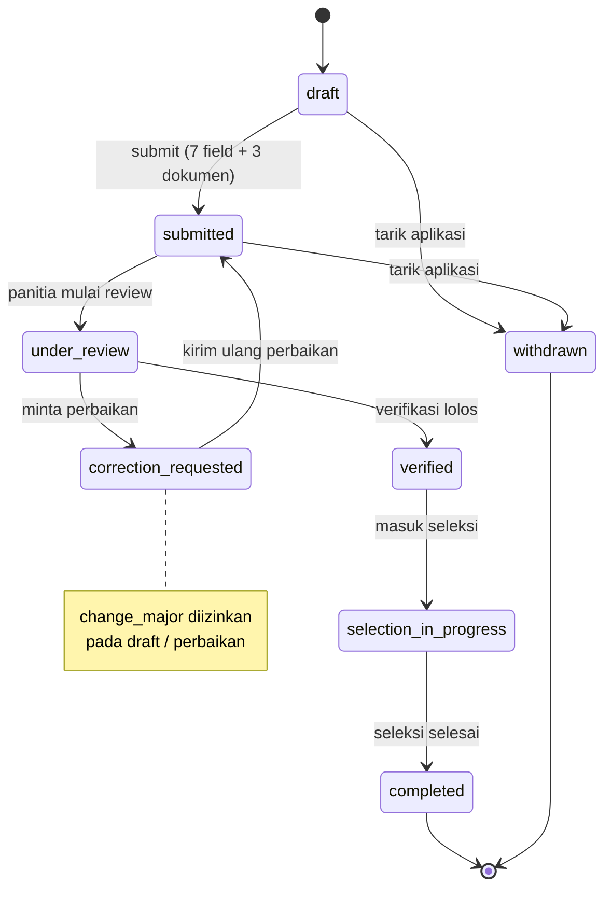

# HF04 — Spesifikasi Integrasi API dan State

> **Sprint 1 — Perencanaan/desain saja.** Dokumen ini bukan implementasi kode dan bukan bukti bahwa backend HTTP sudah ada.
> **Status kontrak HTTP: DIUSULKAN (proposed).** Sampai dokumen ini ditulis, TIDAK ADA backend HTTP, OpenAPI, atau frontend di repo ini. Yang sudah ada dan menjadi ground truth adalah database PostgreSQL 18 (12 tabel) beserta fungsi `bsc_api.*` yang didokumentasikan di `docs/database/INTEGRATION.md`, `docs/database/DATA_DICTIONARY.md`, dan `docs/database/SECURITY.md`. Semua method dan path HTTP dalam dokumen ini adalah **usulan** yang harus disahkan tim backend (Fadlan) sebelum diimplementasikan; fungsi `bsc_api.*` yang dipetakan adalah fungsi yang benar-benar ada di database.

- **Tiket:** HF04
- **Sprint:** Sprint 1 (perencanaan/desain)
- **Reviewer:** Fadlan (Backend)
- **Sumber ground truth:** `docs/database/INTEGRATION.md`, `docs/database/DATA_DICTIONARY.md`, `docs/database/SECURITY.md`

## 1. Tujuan

1. Memetakan setiap layar frontend ke endpoint HTTP **yang diusulkan** dan ke fungsi `bsc_api.*` yang sudah ada, sehingga tim backend dan frontend sepakat tentang kontrak sebelum ada kode.
2. Menetapkan skema field request/response per layar yang diambil langsung dari `DATA_DICTIONARY.md` (nama field, tipe, batas panjang, dan aturan wajib).
3. Menetapkan perilaku state UI yang konsisten per layar: loading, sukses, error, dan kosong.
4. Menetapkan aturan privasi respons: apa yang **tidak boleh** ditampilkan atau diekspos ke browser.

## 2. Ground truth yang mengikat dokumen ini

| Butir | Fakta (dari dokumen database) |
|---|---|
| Database | PostgreSQL 18, skema bisnis `bsc`, 12 tabel |
| Role | `applicant` / `committee` / `admin` (`roles.code`); status akun `active` / `suspended` / `closed` |
| Jurusan | 5 program: TJKT (satu-satunya kode kanonis; `TKJT` ditolak), PPLG, ANIMASI, MPLB, OTOMOTIF. Kode dan nama program **wajib dibaca dari `get_catalog`**, bukan di-hardcode dan bukan dari ID identity |
| Dokumen wajib | 3 jenis: `graduation_proof` (ijazah **ATAU** SKL — satu slot), `family_card`, `photo`; ditambah dokumen pendukung opsional sesuai katalog. Batas **maks 5 MiB per jenis** (`max_size_bytes` default 5.242.880). MIME yang diizinkan: PDF/JPEG/PNG; `photo` hanya JPEG/PNG |
| Status aplikasi | 8 nilai: `draft`, `submitted`, `under_review`, `correction_requested`, `verified`, `selection_in_progress`, `completed`, `withdrawn`. `withdrawn` boleh dari sebelum maupun sesudah submit |
| Profil | 7 field (lihat §4.2): `full_name` 1–150, `birthplace` 1–100, `birth_date` ≥ 1900-01-01 dan ≤ hari ini, `gender` L/P, `address` 1–1000, `phone` E.164 (`+` diikuti 8–15 digit, digit pertama bukan nol), email maks 254 karakter. Tidak ada NIK/NISN |
| Nomor pendaftaran | `BSC-` + UUID tanpa tanda hubung, huruf besar (generated stored, unik) |
| Fungsi `bsc_api.*` | `register_account`, `replace_password_hash`, `save_profile`, `get_catalog`, `create_application`, `change_major`, `put_document`, `change_application_status`, `verify_document`, `save_selection_result`, `publish_selection_result`, `get_application`, `list_applications`, `manage_account` (lihat tabel pemetaan §3) |
| `get_application` | Mengembalikan `application`, `profile`, `documents`, `history`, `verifications`, `selection_result`. `selection_result` bernilai `null` berarti **hasil belum tersedia bagi aktor** — JANGAN disimpulkan sebagai gagal seleksi |
| Submit | Memerlukan 7 field biodata lengkap dan 3 dokumen wajib; snapshot profil dibuat oleh fungsi di server, bukan dari JSON yang dikirim client |
| Upload | Server memeriksa sesi/ownership/state, menerima file ke bucket privat staging, memeriksa isi/MIME/ukuran/malware, membentuk key acak, lalu memanggil `put_document`. Penggantian dokumen wajib memakai key baru; `revision` naik dan status verifikasi kembali `pending` |
| Download | Memakai `get_application` untuk ownership dan tautan privat berumur pendek / stream server; **jangan** menyediakan endpoint publik berdasarkan `storage_key` saja |
| Aktor | `actor` (UUID pengguna) **selalu berasal dari sesi server** yang terverifikasi, tidak pernah dari body/query/header yang dipilih pengguna. Menyembunyikan UUID bukan otorisasi; kontrol UI berdasarkan role **bukan** pengaman utama |

### 2.1 Aturan penamaan endpoint yang diusulkan

- Semua path di bawah ini berawalan `/api/v1/` dan **DIUSULKAN** — belum ada satu pun yang terimplementasi.
- Backend tetap memeriksa otorisasi endpoint dan objek sebelum memanggil fungsi database; fungsi `bsc_api.*` adalah lapis pemeriksaan tambahan, bukan satu-satunya pengaman.
- Fungsi berjalan dalam transaksi pemanggil; commit/rollback diselesaikan backend. Retry terbatas pada error `40001`/`40P01`, bukan semua error.
- Semua parameter dikirim sebagai bind parameter; tidak ada SQL hasil concatenation/interpolasi string.

## 3. Tabel pemetaan UI → endpoint yang diusulkan → fungsi `bsc_api.*`

> Kolom "Endpoint (DIUSULKAN)" berisi method + path usulan. Kolom "Fungsi" berisi fungsi database yang sudah ada. Kolom "Field" merujuk ke `DATA_DICTIONARY.md`.

### 3.1 Layar publik / autentikasi (semua role)

| Layar | Endpoint (DIUSULKAN) | Fungsi `bsc_api.*` | Request field | Response field |
|---|---|---|---|---|
| Beranda / katalog jurusan & periode | `GET /api/v1/catalog` | `get_catalog()` (tanpa parameter) | — | `majors[]` (`code`, `name`, `description`, `is_active`), `periods[]` (`name`, `academic_year`, `opens_at`, `closes_at`, `is_active`), `document_types[]` (`code`, `name`, `is_required`, `max_size_bytes`, `allowed_mime_types`) |
| Registrasi akun | `POST /api/v1/auth/register` | `register_account(email, password_hash)` — hash Argon2id dibuat **backend** dari password yang dikirim lewat TLS; frontend tidak pernah membuat/mengirim hash | `email` (lowercase/trim, pola email, maks 254), `password` (aturan panjang/kompleksitas ditetapkan backend; lihat SECURITY.md K1) | `account_id` (UUID akun applicant). Role tidak dapat dipilih pendaftar — selalu `applicant` |
| Masuk (login) | `POST /api/v1/auth/login` | `bsc_auth.lookup_account(email)` — **hanya pool autentikasi**, bukan pool aplikasi; validasi hash Argon2id oleh library backend, lalu cek `account_status` dan bangun sesi | `email`, `password` | Sesi server (cookie sesi aman; detail mekanisme sesi ditetapkan backend). **Error login generik** — tidak membedakan apakah email ada atau tidak |
| Ganti password | `POST /api/v1/auth/change-password` | `replace_password_hash(actor, hash)` — hanya setelah reautentikasi (password saat ini) atau recovery yang sah; perubahan membatalkan sesi lama | `current_password`, `new_password` | Sukses/gagal generik. Hash tidak pernah dikirim ke frontend dan tidak pernah ditampilkan |
| Keluar (logout) | `POST /api/v1/auth/logout` | — (invalidasi sesi di backend) | — | Sukses generik |

### 3.2 Layar calon siswa (role `applicant`, milik sendiri)

| Layar | Endpoint (DIUSULKAN) | Fungsi `bsc_api.*` | Request field | Response field |
|---|---|---|---|---|
| Profil / biodata (isi & ubah) | `PUT /api/v1/profile` | `save_profile(actor, full_name, birthplace, birth_date, gender, address, phone)` — upsert saat diizinkan; mengembalikan UUID profil sendiri | 7 field profil (§4.2). **Bukan** `email` — email adalah identitas login di tabel `users`, bukan bagian `save_profile` | `profile_id` (UUID). Setelah submit, yang dibaca dari aplikasi adalah **snapshot** profil; halaman edit profil berikutnya perlu endpoint profil tersendiri bila dibutuhkan |
| Buat aplikasi (pilih periode + jurusan) | `POST /api/v1/applications` | `create_application(actor, period, major)` — mengembalikan UUID draft; batas **satu aplikasi per siswa per periode** | `period_id` (UUID, dari katalog), `major_id` (smallint, dari katalog — tampilkan nama program dari katalog, bukan ID) | `application_id` (UUID), `registration_number` (`BSC-<UUID>`), `status: draft` |
| Detail aplikasi saya | `GET /api/v1/applications/{id}` | `get_application(actor, application)` | `id` aplikasi (path) | `application` (`id`, `registration_number`, `period_id`, `major_id`, `status`, `submitted_at`, `profile_snapshot`, `created_at`, `updated_at`), `profile`, `documents[]`, `history[]`, `verifications[]`, `selection_result` (null = belum tersedia, **bukan** gagal) |
| Daftar aplikasi saya | `GET /api/v1/applications?period_id=&limit=&offset=` | `list_applications(actor, period, limit, offset)` — `limit` default 50, rentang 1–100; `offset` default 0 | `period_id` (opsional), `limit`, `offset` | Baris: `id`, `registration_number`, `period_id`, `major_id`, `status`, `created_at` |
| Ganti jurusan | `PATCH /api/v1/applications/{id}/major` | `change_major(actor, application, major)` — hanya saat `draft` / `correction_requested` (perbaikan) | `major_id` (smallint, dari katalog) | Status aplikasi terbaru + `major_id` baru |
| Unggah / ganti dokumen | `POST /api/v1/applications/{id}/documents` (multipart) | `put_document(actor, application, type, storage_key, mime_type, size_bytes)` — dipanggil backend **setelah** file tervalidasi dan tersimpan dengan key acak; penggantian wajib key baru, `revision` naik, verifikasi kembali `pending` | File + `document_type_id` (smallint, dari katalog). Validasi client (§4.3) hanya pendahulu; server memeriksa isi/MIME/ukuran/malware | `document_id` (UUID slot), `verification_status: pending`, `revision` |
| Unduh dokumen saya | `GET /api/v1/applications/{id}/documents/{doc_id}/download` | `get_application(actor, application)` untuk ownership, lalu stream server / tautan privat berumur pendek | — | Stream file. **Bukan** URL publik dari `storage_key` |
| Kirim aplikasi (submit) | `POST /api/v1/applications/{id}/submit` | `change_application_status(actor, application, 'submitted')` — server memeriksa 7 field biodata + 3 dokumen wajib terpenuhi, lalu membuat `profile_snapshot` | — | `status: submitted`, `submitted_at` |
| Tarik aplikasi (withdraw) | `POST /api/v1/applications/{id}/withdraw` | `change_application_status(actor, application, 'withdrawn', note?)` | `note` (opsional, trim 1–1000; jangan isi PII berlebih) | `status: withdrawn` |
| Lihat hasil seleksi | (bagian dari `GET /api/v1/applications/{id}`) | `get_application` — `selection_result` hanya terlihat setelah publish | — | `selection_result`: `outcome` (`accepted` / `waitlisted` / `rejected`), `note`, `announcement_at`, `published_at`. `null` = belum tersedia, **bukan** gagal |

### 3.3 Layar panitia (role `committee`, antrean seluruh periode)

| Layar | Endpoint (DIUSULKAN) | Fungsi `bsc_api.*` | Request field | Response field |
|---|---|---|---|---|
| Antrean aplikasi | `GET /api/v1/committee/applications?period_id=&status=&limit=&offset=` | `list_applications(actor, period, limit, offset)` — panitia melihat antrean seluruh periode | Filter `period_id`, `status`, `limit` (1–100), `offset` | Baris sama seperti §3.2 (tanpa PII berlebih di daftar; detail hanya di layar detail) |
| Detail aplikasi (review) | `GET /api/v1/committee/applications/{id}` | `get_application(actor, application)` | `id` aplikasi | Sama seperti detail calon siswa, sesuai hak baca panitia |
| Ubah status ke review / verifikasi | `POST /api/v1/committee/applications/{id}/status` | `change_application_status(actor, application, status, note?)` — transisi mengikuti state machine database; transisi tidak valid ditolak server | `status` (salah satu dari 8 nilai; yang relevan: `under_review`, `verified`), `note` (opsional, trim 1–1000) | Status terbaru + entri `history` |
| Verifikasi dokumen | `POST /api/v1/committee/documents/{doc_id}/verify` | `verify_document(actor, document, status, note?)` — `approved` / `correction_requested`; **hanya saat aplikasi `under_review`**; `note` wajib saat `correction_requested` | `status`, `note` (wajib bila `correction_requested`, trim 1–1000) | `verification_status` dokumen + `verification_records` (revisi yang diperiksa tercatat) |
| Minta perbaikan (aplikasi) | (melalui endpoint status di atas dengan `status: correction_requested` + `note` wajib) | `change_application_status(actor, application, 'correction_requested', note)` | `note` (wajib, trim 1–1000) | `status: correction_requested` + histori |

### 3.4 Layar admin (role `admin`)

| Layar | Endpoint (DIUSULKAN) | Fungsi `bsc_api.*` | Request field | Response field |
|---|---|---|---|---|
| Daftar & detail aplikasi (seluruh periode) | `GET /api/v1/admin/applications?...` dan `GET /api/v1/admin/applications/{id}` | `list_applications`, `get_application` | Sama seperti panitia | Sama seperti panitia; admin juga dapat membaca `selection_result` **sebelum** publish |
| Simpan hasil seleksi (draft) | `POST /api/v1/admin/applications/{id}/selection-result` | `save_selection_result(actor, application, outcome, note, announcement_at)` — **hanya admin**; mengembalikan UUID hasil draft | `outcome` (`accepted` / `waitlisted` / `rejected`), `note` (trim 1–1000), `announcement_at` (timestamptz, batas terawal publish) | `selection_result_id` (UUID), status draft (`published_at: null`) |
| Publikasikan hasil | `POST /api/v1/admin/applications/{id}/selection-result/publish` | `publish_selection_result(actor, application)` — publish eksplisit **sesudah** jadwal (`announcement_at`) **dan** aplikasi `completed` | — | `published_at` (≥ `announcement_at`) |
| Kelola akun (role/status) | `PATCH /api/v1/admin/accounts/{user_id}` | `manage_account(actor, user, role, status)` — admin mengelola akun **lain**; siswa yang sudah berprofil tetap `applicant` | `role` (`applicant` / `committee` / `admin`), `status` (`active` / `suspended` / `closed`) | Akun terbaru (tanpa hash) |

### 3.5 Yang TIDAK dipetakan (tidak ada fungsi / tidak ada layar)

- Tidak ada endpoint untuk membaca/mengubah `audit_logs`, `application_status_history`, atau `bsc_meta.migrations` secara langsung — histori dibaca lewat `get_application` (`history`), audit hanya ditulis server.
- Tidak ada endpoint penghapusan akun (penghapusan ditahan FK; gunakan status `closed`).
- Tidak ada endpoint publik berbasis `storage_key`, tidak ada URL file publik, dan tidak ada pengiriman `actor`/`role` dari client.

## 4. Skema field per layar

### 4.1 Katalog (dipakai semua layar)

| Field | Sumber | Catatan UI |
|---|---|---|
| `majors[].code` | `majors.code` | TJKT/PPLG/ANIMASI/MPLB/OTOMOTIF; `TKJT` tidak pernah ditampilkan sebagai pilihan |
| `majors[].name` | `majors.name` | Nama program yang ditampilkan ke pengguna |
| `majors[].description` | `majors.description` (maks 2000) | Teks penjelas di layar pilih jurusan |
| `majors[].is_active` | `majors.is_active` | Hanya yang aktif dapat dipilih untuk aplikasi baru |
| `periods[]` | `admission_periods` | `name`, `academic_year` (`YYYY/YYYY`), `opens_at` (inklusif), `closes_at` (eksklusif), `is_active`; periode hanya aktif setelah tanggal dan persyaratan disetujui |
| `document_types[]` | `document_types` | `code`, `name`, `is_required`, `max_size_bytes`, `allowed_mime_types` — UI membaca batas dari sini, bukan hardcode |

### 4.2 Formulir profil — 7 field (`save_profile`)

| Field | Tipe/aturan (DATA_DICTIONARY) | Validasi tampilan |
|---|---|---|
| `full_name` | text, trim 1–150, NOT NULL | Wajib; pesan bila kosong / lebih dari 150 karakter |
| `birthplace` | text, trim 1–100, nullable di DB (wajib saat submit) | Wajib sebelum submit; pesan bila kosong / lebih dari 100 karakter |
| `birth_date` | date, ≥ 1900-01-01, ≤ hari ini | Wajib sebelum submit; date picker membatasi rentang; pesan bila di luar rentang |
| `gender` | text, `L` / `P`, nullable di DB (wajib saat submit) | Pilihan `Laki-laki` / `Perempuan`; nilai yang dikirim tetap `L` / `P` |
| `address` | text, trim 1–1000, nullable di DB (wajib saat submit) | Wajib sebelum submit; textarea; pesan bila lebih dari 1000 karakter |
| `phone` | text, E.164: `+` diikuti 8–15 digit, digit pertama bukan nol | Wajib sebelum submit; contoh format ditampilkan; pesan bila tidak sesuai pola |
| `email` | text, maks 254 (tabel `users`) | **Bukan** field `save_profile`; ditampilkan read-only dari akun bila perlu. Contoh fiktif: `calon.siswa@example.test` |

Contoh data fiktif untuk mockup (bukan data nyata): nama "Calon Siswa Contoh", email `calon.siswa@example.test`, telepon `+6281234567890`, tanggal lahir `2008-05-17`. Semua contoh di dokumen ini memakai data dummy/sintetis.

### 4.3 Unggah dokumen (`put_document`)

| Jenis (kode katalog) | Isi | MIME diizinkan | Maks |
|---|---|---|---|
| `graduation_proof` | Ijazah **ATAU** SKL — satu slot | `application/pdf`, `image/jpeg`, `image/png` | 5 MiB |
| `family_card` | Kartu Keluarga | `application/pdf`, `image/jpeg`, `image/png` | 5 MiB |
| `photo` | Pas foto | `image/jpeg`, `image/png` **saja** (bukan PDF) | 5 MiB |
| Dokumen pendukung | Opsional, sesuai katalog | Sesuai `allowed_mime_types` jenisnya | Sesuai `max_size_bytes` jenisnya (default 5 MiB) |

Aturan: satu slot per jenis per aplikasi (`UNIQUE application_id + document_type_id`); penggantian memakai key baru, `revision` naik, status kembali `pending`; `size_bytes` 1–20 MiB di DB tetapi batas per jenis dari katalog adalah 5 MiB — UI memakai batas katalog. Validasi client (tipe/ukuran) hanya pendahulu; server memeriksa isi file, MIME dari konten, ukuran nyata, dan malware.

### 4.4 Status aplikasi — label UI yang diusulkan

| Status (nilai API) | Label UI yang diusulkan | Siapa melihat |
|---|---|---|
| `draft` | Draf | Calon siswa |
| `submitted` | Terkirim — menunggu review | Calon siswa, panitia, admin |
| `under_review` | Sedang direview | Calon siswa, panitia, admin |
| `correction_requested` | Perlu perbaikan | Calon siswa (dengan catatan), panitia, admin |
| `verified` | Terverifikasi | Calon siswa, panitia, admin |
| `selection_in_progress` | Seleksi berlangsung | Calon siswa, panitia, admin |
| `completed` | Selesai | Calon siswa, panitia, admin |
| `withdrawn` | Ditarik | Calon siswa, panitia, admin |

Label di atas adalah usulan tampilan; nilai yang disimpan/dikirim tetap literal API. Timeline status di UI dibaca dari `history[]` (`previous_status`, `new_status`, `changed_at`, `note`).

### 4.5 Hasil seleksi

| Field | Aturan |
|---|---|
| `outcome` | `accepted` / `waitlisted` / `rejected` |
| `note` | Trim 1–1000 |
| `announcement_at` | Batas terawal publish; `published_at` harus ≥ nilai ini |
| `published_at` | `null` sebelum publish |
| `selection_result: null` | Hasil belum tersedia bagi aktor — tampilkan "Hasil belum diumumkan", **jangan** tampilkan "Tidak lulus" atau kesimpulan lain |

## 5. State loading / error / sukses / kosong per layar

Prinsip umum: setiap layar memiliki keempat state ini; state error tidak pernah menampilkan detail teknis (lihat §7).

| Layar | Loading | Sukses | Error | Kosong |
|---|---|---|---|---|
| Katalog / beranda | Skeleton daftar jurusan & periode | Daftar jurusan (nama dari katalog), periode aktif, persyaratan dokumen | "Katalog tidak dapat dimuat. Coba lagi." + tombol muat ulang | Tidak ada periode aktif → "Belum ada periode penerimaan yang dibuka." |
| Registrasi | Tombol nonaktif + indikator proses | "Akun dibuat. Silakan masuk." lalu arahkan ke login | Pesan generik per §7 (mis. email sudah terdaftar → "Email sudah terdaftar." tanpa detail lain) | — |
| Login | Tombol nonaktif + indikator proses | Masuk ke dasbor sesuai role | "Email atau password salah." (generik, tidak membedakan akun ada/tidak) | — |
| Profil | Skeleton formulir | "Profil tersimpan." | "Profil tidak dapat disimpan. Periksa isian dan coba lagi." | Draf: field kosong dengan placeholder; bukan error |
| Daftar aplikasi | Skeleton tabel/daftar | Daftar aplikasi milik sendiri / antrean panitia | "Daftar tidak dapat dimuat. Coba lagi." | Calon siswa: "Belum ada aplikasi. Buat aplikasi pertama Anda." Panitia: "Tidak ada aplikasi pada antrean ini." |
| Detail aplikasi | Skeleton detail + timeline | Detail lengkap + timeline `history` + dokumen + verifikasi | "Aplikasi tidak ditemukan atau Anda tidak memiliki akses." (403/404 disamakan — jangan bocorkan keberadaan objek) | `history` kosong (draf baru) → timeline hanya menampilkan "Draf dibuat"; `verifications` kosong → "Belum ada pemeriksaan." |
| Unggah dokumen | Progress unggah + status "Memeriksa file…" | Slot menampilkan nama file, ukuran, `revision`, status `pending` | "File tidak dapat diunggah." + alasan ramah yang aman (mis. "Ukuran melebihi 5 MiB." / "Format file tidak didukung.") | Slot belum terisi → area unggah kosong dengan persyaratan jenis/ukuran |
| Submit | Konfirmasi pratinjau → tombol proses | "Aplikasi terkirim." + nomor `BSC-…` | Bila prasyarat belum lengkap: daftar kekurangan (field/dokumen) — bukan detail constraint DB | Pratinjau menampilkan kekurangan sebelum submit |
| Review panitia | Skeleton detail | Keputusan tersimpan; status berubah | "Keputusan tidak dapat disimpan. Status aplikasi mungkin sudah berubah — muat ulang." (kemungkinan race/lock) | Antrean kosong (lihat di atas) |
| Hasil seleksi | Skeleton kartu hasil | Kartu hasil sesuai `outcome` + `note` + tanggal pengumuman | "Hasil tidak dapat dimuat. Coba lagi." | `selection_result: null` → "Hasil belum diumumkan." (bukan gagal) |
| Kelola akun (admin) | Skeleton tabel akun | Perubahan role/status tersimpan | "Perubahan tidak dapat disimpan." | Tidak ada akun pada filter → pesan kosong |

### 5.1 Aturan state tambahan

- **Optimistic update dilarang** untuk perubahan status, verifikasi, dan hasil seleksi: UI menunggu respons server karena state machine dan lock baris di database yang menentukan.
- **Race:** bila dua aktor mengubah objek yang sama, server menolak salah satunya (lock/error `40001`/`40P01` di-retry terbatas di backend); UI menampilkan pesan muat-ulang, bukan mengulang aksi secara diam-diam.
- **Stale data:** setelah aksi berhasil (submit, verifikasi, ganti jurusan), UI memuat ulang detail via `get_application` agar `history`/`verifications` terbaru tampil.
- **Sesi berakhir / akun suspended:** semua layar menampilkan "Sesi Anda telah berakhir. Silakan masuk kembali." dan mengarahkan ke login; tidak ada pesan berbeda untuk akun suspended/closed.

## 6. Diagram interaksi (Mermaid)

```mermaid
sequenceDiagram
    autonumber
    participant U as Calon Siswa (browser)
    participant FE as Frontend (diusulkan)
    participant BE as Backend HTTP (DIUSULKAN, belum ada)
    participant DB as PostgreSQL 18<br/>bsc_api.*
    U->>FE: Buka katalog
    FE->>BE: GET /api/v1/catalog (DIUSULKAN)
    BE->>DB: get_catalog()
    DB-->>BE: majors / periods / document_types
    BE-->>FE: JSON katalog
    FE-->>U: Daftar jurusan (nama dari katalog)
    U->>FE: Isi profil 7 field + pilih jurusan
    FE->>BE: PUT /api/v1/profile (DIUSULKAN)
    BE->>DB: save_profile(actor dari sesi, ...)
    FE->>BE: POST /api/v1/applications (DIUSULKAN)
    BE->>DB: create_application(actor dari sesi, period, major)
    DB-->>BE: UUID draft + BSC-…
    U->>FE: Unggah 3 dokumen wajib
    FE->>BE: POST /api/v1/applications/{id}/documents (DIUSULKAN)
    BE->>BE: Validasi sesi/ownership/state; cek isi/MIME/ukuran/malware; key acak
    BE->>DB: put_document(actor, application, type, key, mime, size)
    U->>FE: Kirim aplikasi
    FE->>BE: POST /api/v1/applications/{id}/submit (DIUSULKAN)
    BE->>DB: change_application_status(actor, application, 'submitted')
    DB-->>BE: status + profile_snapshot (dibuat server)
```

```mermaid
sequenceDiagram
    autonumber
    participant P as Panitia (browser)
    participant FE as Frontend (diusulkan)
    participant BE as Backend HTTP (DIUSULKAN, belum ada)
    participant DB as PostgreSQL 18<br/>bsc_api.*
    P->>FE: Buka antrean
    FE->>BE: GET /api/v1/committee/applications (DIUSULKAN)
    BE->>DB: list_applications(actor dari sesi, ...)
    P->>FE: Buka detail aplikasi
    FE->>BE: GET /api/v1/committee/applications/{id} (DIUSULKAN)
    BE->>DB: get_application(actor, application)
    DB-->>BE: application / profile / documents / history / verifications / selection_result
    P->>FE: Verifikasi dokumen (approved / correction_requested + note)
    FE->>BE: POST /api/v1/committee/documents/{doc_id}/verify (DIUSULKAN)
    BE->>DB: verify_document(actor, document, status, note)
    Note over BE,DB: Hanya saat under_review;<br/>note wajib bila correction_requested
```



> Diagram state di atas adalah ringkasan alur dari nilai status dan catatan di `INTEGRATION.md`/`DATA_DICTIONARY.md`. Matriks transisi definitif ada di state machine database; endpoint yang diusulkan wajib mengikuti matriks tersebut dan menolak transisi di luar matriks dengan error generik (§7).

## 7. Privasi respons & penanganan error

### 7.1 Yang TIDAK BOLEH tampil di UI / respons ke browser

| Dilarang | Alasan / sumber |
|---|---|
| `password_hash` (atau hash apa pun) | SECURITY.md K1 — hash tidak dikembalikan API aplikasi; jangan mengirim hash ke frontend |
| `storage_key` sebagai tautan publik | SECURITY.md — key memakai UUID, bukan bukti hak akses; download hanya lewat otorisasi + stream/tautan privat berumur pendek |
| Detail error SQL: SQLSTATE, nama constraint/tabel, stack trace, isi query | INTEGRATION.md — jangan mengirim SQLSTATE/detail constraint/row/hash mentah ke client |
| Nama file asli di dalam DB / metadata yang memuat PII berlebih | SECURITY.md — tidak ada nama file asli dalam DB |
| `role` dari client sebagai pengaman | INTEGRATION.md — aktor berasal dari sesi server; kontrol UI berdasarkan role bukan pengaman utama |
| PII berlebih di `note` (password, token, diagnosis, data keluarga yang tidak perlu) | SECURITY.md — catatan dibatasi 1000 karakter dan perlu validasi/redaksi backend |
| Keberadaan objek lewat perbedaan 403/404 | INTEGRATION.md — `42501` → 403 atau 404 generik sesuai endpoint, jangan bocorkan keberadaan objek |

### 7.2 Pemetaan error yang disarankan (dari INTEGRATION.md)

| Kondisi server | Respons HTTP yang diusulkan | Pesan UI |
|---|---|---|
| `42501` (izin ditolak) | 403 atau 404 generik sesuai endpoint | "Tidak ditemukan atau Anda tidak memiliki akses." |
| `23505` (duplikat, mis. satu aplikasi per periode / email sudah terdaftar) | 409 generik | "Data sudah ada." / "Email sudah terdaftar." |
| `23514` / `23502` / `23503` / `23001` / `22P02` (validasi/constraint/tipe) | 400 / 422 generik | "Periksa isian Anda dan coba lagi." + penanda field bila aman |
| Error lain | 500 + **request ID** yang aman | "Terjadi kesalahan. Coba lagi. (ID: `<request-id>`)" — request ID hanya untuk pelacakan oleh tim, tanpa detail teknis |
| Login gagal | 401 generik | "Email atau password salah." |
| Sesi berakhir / akun suspended/closed | 401 generik | "Sesi Anda telah berakhir. Silakan masuk kembali." |

### 7.3 Aturan tampilan data

- Nomor pendaftaran `BSC-<UUID>` boleh ditampilkan (ini identitas aplikasi yang memang untuk ditampilkan ke pemiliknya).
- `profile_snapshot` ditampilkan sebagai data yang dibaca dari aplikasi; jelaskan di UI bahwa itu adalah biodata saat pengiriman terakhir.
- `history` dan `verifications` ditampilkan sebagai timeline/catatan dengan aktor yang disamarkan secukupnya (mis. "Panitia" tanpa nama pribadi bila kebijakan sekolah menghendaki).
- Dokumen ditampilkan berdasarkan nama jenis + status verifikasi + revisi, bukan berdasarkan `storage_key` atau nama file asli.
- Akses baca PII oleh panitia perlu audit akses pada endpoint sesuai kebijakan sekolah (catatan SECURITY.md) — di luar cakupan Sprint 1, dicatat sebagai tindak lanjut untuk backend.

## 8. Daftar periksa sebelum implementasi (untuk Fadlan)

- [ ] Sahkan method + path setiap endpoint yang diusulkan di §3 (atau ajukan perubahan).
- [ ] Sahkan mekanisme sesi/cookie, CSRF, rate limit, verifikasi email, dan pemulihan akun (K1).
- [ ] Sahkan bentuk respons error generik + request ID (§7.2).
- [ ] Sahkan bahwa `actor` selalu diambil dari sesi server, bukan dari request client.
- [ ] Sahkan penanganan race (retry terbatas `40001`/`40P01`) dan pesan muat-ulang di UI.
- [ ] Sahkan kebijakan audit akses baca PII panitia.

## Status review

**Review PENDING — persetujuan BELUM diperoleh.** Dokumen ini menunggu review oleh **Fadlan** (Backend). Tidak ada persetujuan atas endpoint yang diusulkan, skema field, maupun diagram di atas yang diklaim telah diberikan oleh Fadlan, Samuel, Rizki, atau siapa pun. Semua endpoint HTTP berlabel **DIUSULKAN** sampai Fadlan menyahkannya.
