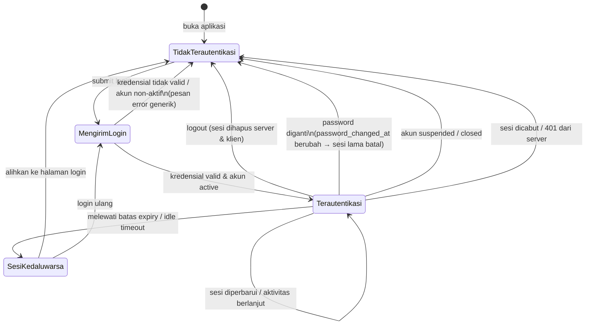

# HF07 — Desain Keamanan K1: Autentikasi dan Sesi

> **Sprint 1 — Perencanaan/desain saja.** Dokumen ini BUKAN implementasi kode dan BUKAN
> dokumentasi sistem yang sudah ada. Saat ini **tidak ada backend HTTP, endpoint, atau
> sesi yang existing** di repo ini; semua yang dirancang di bawah adalah **desain yang
> diusulkan untuk backend (Fadlan)** dan harus disepakati serta diimplementasikan oleh
> backend sebelum dapat diuji. Frontend tidak boleh menganggap alur di bawah sudah
> berjalan.

## 1. Tujuan

Merancang alur autentikasi dan sesi frontend BSC Admissions (SMK Bina Sarana
Cendekia) yang selaras dengan kontrol K1 di `docs/database/SECURITY.md` dan kontrak
integrasi di `docs/database/INTEGRATION.md`, dengan prinsip: **UI bukan satu-satunya
penegakan keamanan; server tetap mengotorisasi setiap permintaan.**

Ground truth yang mengikat desain ini:

- PostgreSQL 18; peran `applicant` / `committee` / `admin`; status akun
  `active` / `suspended` / `closed`.
- Email unik, dinormalisasi (lowercase/trim), pola email, maks 254 karakter.
- `password_hash` wajib format PHC Argon2id v19 (90–512 karakter;
  m = 19456–1048576 KiB, t = 2–20, p = 1–16; baseline yang kompatibel
  m = 65536 KiB, t = 3, p = 1). Tidak ada password plaintext, akun seed, atau
  administrator default di database.
- `password_changed_at` mendukung invalidasi sesi oleh backend.
- Fungsi yang relevan: `bsc_api.register_account(email, password_hash)`,
  `bsc_auth.lookup_account(email)` (hanya pool autentikasi, hash tidak
  dikembalikan ke API aplikasi), dan `bsc_api.replace_password_hash(actor, hash)`.

## 2. Alur registrasi (diusulkan)

1. Pengguna membuka halaman registrasi dan mengisi email + password.
   Contoh fiktif: nama "Calon Siswa Contoh", email `calon.contoh@example.test`.
2. Frontend memvalidasi format di sisi klien (lihat HF09 untuk batas dan pesan
   error): email sesuai pola dan maks 254 karakter; password memenuhi panjang
   minimum yang ditetapkan backend (panjang minimum adalah keputusan backend,
   bukan database — CHECK PHC hanya memvalidasi format hash, bukan kekuatan
   password).
3. Frontend mengirim email + password ke backend melalui TLS. Password
   **tidak pernah** disimpan, dicatat (log), atau ditampilkan kembali oleh
   frontend.
4. Backend: menormalisasi email (lowercase/trim), memvalidasi, membuat hash
   Argon2id dengan salt acak per password memakai library Argon2id terawat,
   lalu memanggil `bsc_api.register_account`. Fungsi ini **tidak menerima
   role** — akun baru selalu `applicant` (role default di database).
5. Backend mengembalikan respons generik. Jika email sudah terdaftar, respons
   yang diterima frontend **tidak boleh membedakan** apakah email sudah ada
   atau tidak (lihat §6), agar tidak terjadi enumerasi akun.
6. Verifikasi email dan pemulihan akun adalah **kebutuhan backend** yang
   masih harus dirancang (SECURITY.md menyebut keduanya sebagai kewajiban
   backend); frontend hanya menyediakan halaman/tampilan sesuai kontrak yang
   nanti disepakati dengan Fadlan. Desain ini tidak mengklaim keduanya sudah
   ada.

## 3. Alur login (diusulkan)

1. Pengguna mengisi email + password pada halaman login.
2. Frontend mengirim kredensial ke backend melalui TLS. Kredensial tidak
   disimpan di sisi klien dalam bentuk apa pun (lihat §5).
3. Backend: lookup melalui `bsc_auth.lookup_account` (pool autentikasi
   terpisah), verifikasi hash dengan library Argon2id, memeriksa
   `account_status = active`, lalu membangun sesi server-side.
4. Jika verifikasi berhasil, backend menetapkan cookie sesi (lihat §5) dan
   frontend mengarahkan pengguna ke halaman sesuai perannya (lihat HF08
   untuk menu dan rute per peran).
5. Jika verifikasi gagal — karena email tidak ada, password salah, atau akun
   `suspended`/`closed` — backend mengembalikan **satu pesan error generik
   yang sama** untuk semua kasus (lihat §6). Frontend menampilkan pesan itu
   apa adanya dan tidak menambahkan penjelasan yang membedakan penyebabnya.
6. Backend wajib melakukan rehash saat parameter Argon2id berubah, dan
   `replace_password_hash` hanya boleh dipanggil setelah reautentikasi
   (password saat ini) atau recovery yang sah.

## 4. State machine sesi (diusulkan)

Catatan:

- Status sesi adalah **keputusan server**, bukan keputusan frontend.
  Frontend hanya mencerminkan status yang dikembalikan server (misalnya
  respons 401) dan mengarahkan pengguna ke login.
- `password_changed_at` adalah batas invalidasi sesi: setiap sesi yang dibuat
  sebelum waktu tersebut dianggap tidak berlaku oleh backend.

## 5. Penyimpanan token/sesi — JANGAN PERNAH localStorage

### 5.1 Larangan

Frontend **dilarang keras** menyimpan password, token, atau data sesi apa pun
di `localStorage` (juga `sessionStorage` untuk token/sesi). Larangan ini
berlaku tanpa pengecualian.

**Kenapa:** `localStorage` dapat dibaca oleh JavaScript apa pun yang berjalan
di origin yang sama. Jika ada satu celah XSS (misalnya data pengguna yang
dirender tanpa escaping — lihat HF09), penyerang dapat membaca token/sesi
dari `localStorage` dan mengambil alih akun, meskipun backend sudah benar.
Penyimpanan di `localStorage` mengubah satu celah rendering menjadi
pengambilalihan akun penuh. Selain itu, isi `localStorage` bertahan setelah
browser ditutup dan tidak memiliki mekanisme expiry/revokasi yang dikendalikan
server.

### 5.2 Alternatif yang diusulkan (oleh backend)

Sesi dikelola **server-side** dan dibawa oleh **cookie** yang ditetapkan
oleh backend, dengan atribut:

| Atribut cookie | Tujuan |
|---|---|
| `HttpOnly` | Cookie tidak dapat dibaca JavaScript — token/sesi tidak terekspos ke XSS di sisi klien. |
| `Secure` | Cookie hanya dikirim melalui HTTPS/TLS. |
| `SameSite` | Membatasi pengiriman cookie lintas situs; nilai pastinya (`Lax`/`Strict`) diputuskan backend sesuai arsitektur. |
| `Path` / `Domain` | Dibatasi sesempit mungkin oleh backend. |
| Expiry | Sesuai §7; cookie sesi berakhir saat sesi berakhir. |

Frontend **tidak pernah** membaca, menulis, atau memodifikasi cookie sesi
secara langsung; cookie diatur dan dihapus oleh backend melalui header
`Set-Cookie`. Frontend hanya mengirim permintaan dengan kredensial cookie
sesuai mekanisme browser (misalnya `credentials: include` pada fetch — detail
implementasi ini diputuskan saat implementasi, bukan di Sprint 1).

### 5.3 Larangan terkait lainnya

- Jangan mengirim `password_hash` ke frontend dalam bentuk apa pun
  (SECURITY.md: "Jangan mengirim hash ke frontend").
- Jangan menyimpan password di memori aplikasi lebih lama dari yang
  diperlukan untuk satu permintaan login/registrasi/ganti password; kosongkan
  field password setelah pengiriman.
- Jangan mencatat (log) password, token, hash, atau isi cookie sesi di
  console, log frontend, atau laporan error.
- Jangan menaruh token/sesi di URL (query string) — URL dapat tersimpan di
  riwayat browser, log server, dan referrer.

## 6. Pesan error login generik

| Situasi di server | Yang ditampilkan frontend |
|---|---|
| Email tidak terdaftar | "Email atau password salah. Silakan coba lagi." |
| Password salah | "Email atau password salah. Silakan coba lagi." |
| Akun `suspended` | "Email atau password salah. Silakan coba lagi." |
| Akun `closed` | "Email atau password salah. Silakan coba lagi." |
| Akun belum terverifikasi (jika backend memberlakukannya) | Pesan generik yang sama, kecuali backend dan tim memutuskan alur verifikasi terpisah — keputusan ini belum dibuat. |

Prinsip: **jangan pernah membedakan apakah akun ada atau tidak.** Auth lookup
di database belum membedakan respons HTTP email ada/tidak, dan backend wajib
mencegah enumerasi akun. Frontend tidak boleh menambahkan pesan, kode, atau
perilaku (misalnya waktu respons yang berbeda secara sengaja) yang membocorkan
keberadaan akun.

Pesan error teknis (detail SQL, SQLSTATE, nama constraint, stack trace, hash)
**tidak boleh** ditampilkan ke pengguna; backend mengembalikan pesan generik
dan request ID yang aman bila diperlukan.

## 7. Expiry sesi (diusulkan, diputuskan backend)

| Aspek | Usulan desain |
|---|---|
| Expiry absolut | Sesi memiliki batas waktu maksimum sejak login; nilai pastinya (misalnya 8 jam / 24 jam) **diputuskan backend** dan belum ditetapkan dalam desain ini. |
| Idle timeout | Sesi berakhir setelah periode tanpa aktivitas; nilai pastinya diputuskan backend. |
| Perpanjangan (sliding) | Apakah sesi diperpanjang oleh aktivitas atau tidak, diputuskan backend; frontend tidak memperpanjang sesi sendiri. |
| Sesi usai ganti password | Semua sesi yang dibuat sebelum `password_changed_at` yang baru menjadi tidak berlaku; pengguna harus login ulang di semua perangkat/sesi. |
| Sesi usai logout | Lihat §8. |

Frontend hanya perlu: (a) mengarahkan ke login saat server mengembalikan 401
atau menyatakan sesi kedaluwarsa, dan (b) tidak menyimpan status sesi secara
lokal sebagai sumber kebenaran.

## 8. Logout — menghapus data sesi

1. Pengguna menekan logout.
2. Frontend memanggil endpoint logout backend (kontrak HTTP belum ada —
   endpoint ini adalah **kebutuhan backend** yang diusulkan).
3. Backend menghapus/mencabut sesi di sisi server dan menghapus cookie sesi
   melalui `Set-Cookie` (expiry di masa lalu).
4. Frontend menghapus seluruh state autentikasi di memori aplikasi (nama
   pengguna yang ditampilkan, peran untuk menu, data profil/aplikasi yang
   dimuat), mengosongkan field password, dan mengarahkan ke halaman login.
5. Setelah logout, tombol "kembali" (back) browser **tidak boleh**
   menampilkan kembali data terautentikasi dari cache lokal — halaman
   terautentikasi harus memvalidasi ulang sesi ke server sebelum menampilkan
   data. Detail mekanisme cache diputuskan saat implementasi.

## 9. Ganti password (diusulkan)

1. Pengguna yang sedang login membuka halaman ganti password dan mengisi
   password saat ini + password baru.
2. Frontend mengirim ketiganya ke backend melalui TLS; tidak menyimpan
   password di sisi klien.
3. Backend melakukan **reautentikasi** (memverifikasi password saat ini)
   sebelum memanggil `bsc_api.replace_password_hash`. Tanpa reautentikasi,
   pergantian hash tidak boleh dilakukan.
4. Backend memperbarui hash (Argon2id, salt acak baru) dan
   `password_changed_at` berubah — akibatnya **semua sesi lama batal**,
   termasuk sesi di perangkat lain dan sesi yang sedang dipakai. Pengguna
   diarahkan login ulang.
5. Frontend menampilkan konfirmasi generik ("Password berhasil diganti.
   Silakan login kembali.") dan menghapus state sesi lokal seperti pada
   logout (§8).

## 10. Rate limit & lockout — kebutuhan backend

Frontend **tidak** mengimplementasikan rate limit atau lockout; keduanya
adalah **kebutuhan backend** yang diusulkan, karena hanya server yang dapat
menegakkannya secara andal:

| Kebutuhan | Usulan untuk backend |
|---|---|
| Rate limit login | Batasi jumlah percobaan login per alamat IP dan/atau per akun dalam jendela waktu; nilai pastinya diputuskan backend. |
| Lockout / penundaan | Setelah sejumlah percobaan gagal, perlambat atau kunci sementara percobaan login; durasi dan ambang diputuskan backend. |
| Respons saat dibatasi | Backend mengembalikan respons generik (misalnya 429 dengan pesan "Terlalu banyak percobaan. Coba lagi nanti.") tanpa membocorkan apakah akun ada. |
| Peran frontend | Menampilkan pesan backend apa adanya; tidak menghitung percobaan sendiri dan tidak menonaktifkan tombol login berdasarkan hitungan lokal sebagai pengganti rate limit server. Frontend boleh menonaktifkan tombol saat satu permintaan sedang diproses (mencegah double-submit), itu saja. |
| Credential stuffing | Pengujian credential stuffing/rate limit termasuk dalam daftar tes HTTP yang diusulkan untuk Rizki (QA/DevSecOps) di INTEGRATION.md, setelah backend tersedia. |

## 11. Hal yang secara eksplisit belum diputuskan / di luar cakupan desain ini

- Nilai pasti expiry sesi, idle timeout, ambang rate limit, dan durasi
  lockout (diputuskan backend).
- Kontrak HTTP/endpoint, format cookie, dan perlindungan CSRF sesuai
  arsitektur (diputuskan backend; SECURITY.md mewajibkan backend mengatur
  CSRF sesuai arsitektur).
- Alur verifikasi email dan pemulihan akun (kebutuhan backend).
- Panjang minimum password (diputuskan backend; database hanya memvalidasi
  format hash).

## Status review

**Status: PENDING.** Dokumen ini adalah desain Sprint 1 yang diusulkan dan
**belum direview**. Persetujuan **belum diperoleh** dari reviewer yang
ditunjuk, **Fadlan** (backend). Tidak ada bagian dari desain ini yang boleh
dianggap disetujui atau siap diimplementasikan sebelum review Fadlan selesai
dan persetujuan dicatat.
