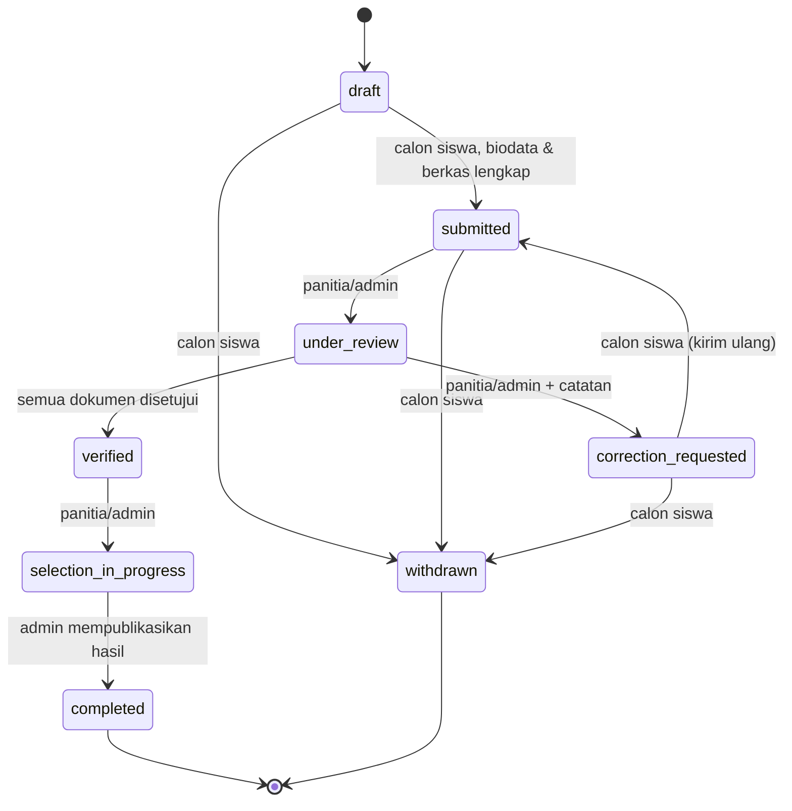

# HF10 — Desain Unggah, Status, dan Pengumuman

## Tujuan

Dokumen ini merancang pengalaman unggah dokumen, tampilan linimasa status aplikasi, dan aturan visibilitas pengumuman hasil seleksi pada frontend BSC Admissions (SMK Bina Sarana Cendekia). Sprint 1 adalah perencanaan/desain saja: dokumen ini bukan implementasi dan tidak mengandung kode aplikasi.

Dasar rancangan adalah kontrak database pada `docs/database/INTEGRATION.md`, `DATA_DICTIONARY.md`, `SECURITY.md`, dan `DESIGN.md`. Tidak ada backend HTTP atau frontend existing saat dokumen ini ditulis (12 November 2026), sehingga seluruh interaksi frontend pada dokumen ini dirancang terhadap fungsi `bsc_api.*` melalui backend yang akan dibangun pada Sprint 2+.

## 1. Desain unggah dokumen

### 1.1 Jenis dokumen

Tiga dokumen wajib, sesuai `document_types` dan `INTEGRATION.md`:

| Kode | Nama | Wajib | Format yang diizinkan | Keterangan |
|---|---|---|---|---|
| `graduation_proof` | Bukti kelulusan | Ya | PDF, JPEG, PNG | Satu slot: ijazah **ATAU** SKL, bukan dua persyaratan terpisah |
| `family_card` | Kartu keluarga | Ya | PDF, JPEG, PNG | — |
| `photo` | Pas foto | Ya | JPEG, PNG | **Tidak menerima PDF** |
| `supporting` | Dokumen pendukung | Tidak | PDF, JPEG, PNG | Satu slot; kebutuhan beberapa file pendukung memerlukan pengembangan model |

Seluruh daftar jenis, status wajib, dan batas ukuran diambil dari `bsc_api.get_catalog` pada saat halaman dimuat — bukan dari daftar hardcoded di frontend. Frontend hanya menampilkan nama dari katalog; kode `TJKT` adalah satu-satunya kode jurusan kanonis.

### 1.2 Batas ukuran dan format

- Batas ukuran: **maksimum 5 MiB per jenis dokumen** (default `max_size_bytes` 5242880 pada `document_types`; batas per jenis dapat berbeda sesuai konfigurasi dan harus dibaca dari katalog).
- Ukuran minimum 1 byte; ukuran 0 tidak diterima.
- MIME yang diizinkan per jenis: PDF (`application/pdf`), JPEG (`image/jpeg`), PNG (`image/png`). Untuk `photo`, hanya JPEG dan PNG.
- Validasi awal dilakukan di sisi klien (ekstensi dan ukuran) untuk memberi umpan balik cepat, tetapi **keputusan akhir selalu di server**: backend memeriksa isi/MIME dari konten, ukuran nyata, dan pemindaian malware sebelum memanggil `bsc_api.put_document`. Validasi klien bukan pengaman.

### 1.3 Alur unggah (desain interaksi)

1. Calon siswa membuka halaman unggah pada aplikasi berstatus `draft` atau `correction_requested`. Di luar kedua status tersebut, unggah tidak tersedia (perubahan jurusan/unggah hanya ketika draft atau perbaikan — lihat `DESIGN.md`).
2. Untuk setiap slot dokumen, halaman menampilkan: nama dokumen, status wajib/opsional, format yang diizinkan, batas ukuran, status verifikasi terkini (`pending` / `approved` / `correction_requested`), dan nomor revisi.
3. Calon siswa memilih file. Frontend memeriksa ukuran dan tipe sebelum mengirim; file yang melanggar ditolak langsung dengan pesan yang jelas (lihat §1.5).
4. Selama pengiriman, tampilkan indikator progres unggah (persentase dan/atau bilah progres) serta status "mengunggah…". Tombol kirim/unggah dinonaktifkan selama proses berlangsung untuk mencegah unggah ganda.
5. Setelah server memvalidasi dan menyimpan file ke bucket privat staging, server membentuk `storage_key` acak dan memanggil `bsc_api.put_document`. Frontend menampilkan konfirmasi berhasil beserta nama file, ukuran, dan nomor revisi baru.
6. File yang gagal divalidasi server (tipe tidak cocok dengan isi, ukuran melebihi batas, atau gagal pemindaian) ditolak dan tidak dicatat sebagai dokumen; pengguna dapat mencoba lagi dengan file lain.

### 1.4 Mengganti file: revisi baru

- Mengganti file pada suatu slot **wajib memakai `storage_key` baru** dan **mereset status verifikasi menjadi `pending`** serta **menaikkan nomor revisi** (`revision` bertambah; revisi awal = 1). Ini adalah perilaku `bsc_api.put_document` pada database.
- Penggantian hanya dimungkinkan saat aplikasi berstatus `draft` atau `correction_requested`.
- Setelah penggantian, catatan verifikasi sebelumnya tetap merujuk pada nomor revisi lama (`verification_records.document_revision`); verifikasi baru yang dilakukan panitia menyimpan nomor revisi yang diperiksa.
- Riwayat metadata/file lengkap setiap revisi **belum disimpan** pada versi awal database; desain ini tidak mengklaim adanya riwayat revisi lengkap. Yang ditampilkan kepada pengguna adalah revisi terkini beserta status verifikasinya.
- Penggantian file tidak mengubah status aplikasi secara otomatis. Jika aplikasi berstatus `correction_requested`, calon siswa tetap harus mengirim ulang aplikasi (`correction_requested` → `submitted`) setelah seluruh perbaikan selesai.

### 1.5 Pesan kesalahan (desain)

Pesan kesalahan harus generik, jelas, dan tidak membocorkan detail internal (tidak menampilkan SQLSTATE, nama constraint, nama tabel, atau `storage_key`).

| Kondisi | Pesan yang ditampilkan (contoh) |
|---|---|
| File melebihi 5 MiB | "Ukuran file melebihi batas 5 MiB untuk dokumen ini. Silakan pilih file yang lebih kecil." |
| Format tidak diizinkan (mis. PDF untuk pas foto) | "Format file tidak diizinkan untuk pas foto. Gunakan JPEG atau PNG." |
| File kosong | "File yang dipilih kosong. Silakan pilih file yang valid." |
| Gagal validasi server / file bermasalah | "File tidak dapat diproses. Pastikan file tidak rusak dan coba lagi." |
| Koneksi terputus saat unggah | "Unggahan terputus. Silakan coba lagi." |
| Unggah di luar status yang diizinkan | "Dokumen tidak dapat diubah pada status aplikasi saat ini." |
| Kesalahan server tak terduga | "Terjadi kesalahan. Silakan coba lagi nanti." (dengan ID permintaan aman bila tersedia) |

Catatan: pesan-pesan di atas adalah rancangan teks antarmuka, bukan string yang sudah disetujui. Teks final ditetapkan pada saat implementasi (Sprint 2+).

### 1.6 UX file privat

- Dokumen disimpan di object storage privat. Database hanya menyimpan `storage_key` acak (`applications/<application_uuid>/<object_uuid>`), MIME, ukuran, revisi, dan status verifikasi. **Tidak ada URL publik, nama file asli, atau konten file di database.**
- Frontend **tidak boleh** menampilkan `storage_key` sebagai tautan publik, dan tidak boleh membangun URL unduhan dari `storage_key` saja. `storage_key` bukan bukti hak akses.
- Unduhan/pratinjau dokumen hanya melalui server: backend memeriksa sesi dan ownership melalui `bsc_api.get_application`, lalu menyediakan tautan privat berumur pendek atau stream server. Tanpa otorisasi server, file tidak dapat diakses.
- Nama file asli yang dipilih pengguna boleh ditampilkan sebagai label pada halaman unggah miliknya sendiri, tetapi nama tersebut tidak disimpan di database dan tidak boleh dipakai sebagai pengenal file.
- Panitia/admin melihat dokumen hanya melalui alur review yang diautorisasi server, pada aplikasi yang dapat mereka lihat (lihat §3).

## 2. Linimasa status aplikasi

### 2.1 Delapan status

Status aplikasi (nilai `applications.status`), sesuai `DATA_DICTIONARY.md` dan `DESIGN.md`:

1. `draft`
2. `submitted`
3. `under_review`
4. `correction_requested`
5. `verified`
6. `selection_in_progress`
7. `completed`
8. `withdrawn`

Label berbahasa Indonesia yang ditampilkan kepada pengguna (rancangan, belum disahkan):

| Status | Label tampilan |
|---|---|
| `draft` | Draf |
| `submitted` | Terkirim |
| `under_review` | Sedang direview |
| `correction_requested` | Perlu perbaikan |
| `verified` | Terverifikasi |
| `selection_in_progress` | Seleksi berlangsung |
| `completed` | Selesai |
| `withdrawn` | Ditarik |

### 2.2 Diagram state (Mermaid)

Ketentuan transisi (dari `DESIGN.md` dan fungsi `bsc_api.change_application_status`):

- `completed` dan `withdrawn` adalah status terminal pada kontrak awal.
- Pengiriman (`draft` → `submitted`) hanya ketika periode aktif dan berada pada interval `[opens_at, closes_at)`, jurusan aktif, tujuh field biodata lengkap, dan tiga dokumen wajib terunggah.
- Perbaikan melewati batas tutup periode belum diizinkan sebagai asumsi konservatif (perlu keputusan tim pada migration berikutnya bila diubah).
- `submitted_at` mempertahankan waktu pengiriman pertama; histori (`application_status_history`) memuat seluruh pengiriman ulang.
- `profile_snapshot` berisi tujuh field biodata pada pengiriman terakhir dan dibuat oleh fungsi, bukan dari JSON yang dikirim klien.
- Perubahan status dilakukan melalui `bsc_api.change_application_status`; frontend tidak mengubah status secara langsung.

### 2.3 Tampilan linimasa (desain)

- Halaman detail aplikasi menampilkan linimasa status berdasarkan `history` dari `bsc_api.get_application` (riwayat append-only `application_status_history`).
- Setiap entri linimasa menampilkan: status tujuan, waktu perubahan (`changed_at`, ditampilkan dalam zona Asia/Jakarta), dan catatan bila ada (`note`, maksimal 1000 karakter; jangan menampilkan PII berlebih).
- Status saat ini ditandai jelas; status yang sudah dilewati ditandai selesai; status terminal (`completed`/`withdrawn`) menutup linimasa.
- Untuk status `correction_requested`, linimasa menampilkan catatan perbaikan dari panitia beserta daftar dokumen yang berstatus `correction_requested` dan nomor revisinya, agar calon siswa tahu apa yang harus diperbaiki.
- Linimasa tidak menampilkan informasi internal: tidak ada hash, detail error SQL, `storage_key`, atau identitas aktor selain yang memang perlu ditampilkan sesuai peran (mis. panitia melihat siapa yang melakukan perubahan; calon siswa hanya melihat status dan catatannya).
- Bila `get_application` mengembalikan `selection_result` null, linimasa tidak menampilkan kesimpulan apa pun tentang hasil seleksi (lihat §3).

## 3. Aturan visibilitas pengumuman

### 3.1 Prinsip dasar

- `selection_result` null berarti **hasil belum tersedia bagi aktor tersebut**. Frontend **dilarang menyimpulkan** bahwa calon siswa gagal/ditolak dari nilai null. Tampilan yang benar untuk hasil null adalah "Hasil belum tersedia" atau "Pengumuman belum diterbitkan" — bukan "Tidak lolos" atau pesan sejenis.
- Hasil seleksi (`accepted` / `waitlisted` / `rejected`) hanya menjadi terlihat setelah admin memanggil `bsc_api.publish_selection_result` secara eksplisit, dan hanya setelah `announcement_at` terpenuhi. Tidak ada publikasi otomatis hanya karena waktu telah tiba.
- Setelah publish, hasil **tidak dapat diubah**. Publikasi sekaligus mengubah aplikasi menjadi `completed`. Ralat hasil atau promosi waitlist memerlukan workflow baru yang ditinjau tim — bukan bagian dari kontrak awal.

### 3.2 Matriks visibilitas

| Aktor | Sebelum publish | Sesudah publish |
|---|---|---|
| Calon siswa (pemilik aplikasi) | Tidak melihat hasil; tampil "Hasil belum tersedia" | Melihat hasil **miliknya sendiri** saja |
| Calon siswa lain | Tidak melihat hasil aplikasi orang lain | Tidak melihat hasil aplikasi orang lain |
| Panitia | Tidak melihat hasil | Melihat hasil pada aplikasi yang dapat mereka lihat |
| Admin | Melihat hasil (draft hasil yang disimpan via `save_selection_result`) | Melihat hasil |

Dasar aturan ini adalah `SECURITY.md` (K2 — RBAC dan ownership) dan `INTEGRATION.md` (`get_application` memberi hasil privat yang terbatas oleh ownership/role).

### 3.3 Desain tampilan pengumuman

- **Sebelum publish (calon siswa):** halaman pengumuman menampilkan status netral, contoh: "Hasil seleksi belum diumumkan. Silakan periksa kembali setelah jadwal pengumuman." Tidak ada indikasi hasil, tidak ada perbedaan tampilan antara calon siswa yang akan diterima dan yang tidak.
- **Sesudah publish (calon siswa):** halaman menampilkan hasil miliknya sendiri (`accepted` / `waitlisted` / `rejected`) beserta catatan (`note`) dari `selection_results` bila ada, dan waktu publikasi (`published_at`).
- **Admin (sebelum publish):** antarmuka admin menampilkan hasil draft yang sudah disimpan (`save_selection_result`) beserta `announcement_at`, dan tombol publish yang hanya aktif setelah jadwal terpenuhi dan aplikasi berstatus `selection_in_progress`. Publish adalah aksi eksplisit admin.
- **Panitia:** tidak memiliki akses simpan/publish hasil. Panitia hanya melihat hasil setelah publish, pada aplikasi yang dapat mereka lihat.
- Nomor pendaftaran (`registration_number`, format `BSC-<UUID>`) ditampilkan sebagai pengenal aplikasi; nomor ini bukan faktor autentikasi dan tidak boleh dipakai sebagai satu-satunya bukti kepemilikan.

### 3.4 Hal-hal yang tidak dirancang di sini

- Isi pengumuman resmi sekolah (teks pengumuman, tata cara daftar ulang, dan sejenisnya) bukan bagian dokumen ini; perlu pengesahan Samuel (BA/UI/UX) dan sekolah.
- Workflow ralat hasil dan promosi waitlist tidak dirancang di sini; keduanya memerlukan keputusan tim dan migration berikutnya.

## 4. Keterkaitan dengan dokumen lain

- HF01–HF09 (sitemap, routing, arsitektur, spesifikasi API, sistem komponen, responsif/aksesibilitas, desain keamanan K1/K2/K3, desain unggah — sesuai cakupan masing-masing) dan dokumen ini bersama-sama membentuk paket perencanaan Sprint 1. Dokumen HF11 berisi checklist review atas seluruh paket tersebut.
- Kontrak database: `docs/database/INTEGRATION.md`, `DATA_DICTIONARY.md`, `SECURITY.md`, `DESIGN.md`.

## Status review

Review **PENDING**. Persetujuan **BELUM diperoleh**. Reviewer dokumen ini: **Samuel**. Dokumen ini ditulis pada 12 November 2026 sebagai bagian dari paket perencanaan Sprint 1; tanggal Sprint 1 (2–8 November 2026) sudah lewat saat dokumen ini diproduksi, dan tidak ada klaim bahwa pekerjaan ini dilakukan pada 2–8 November 2026. Komentar dan tindak lanjut review dicatat pada HF11.
